# Token Quotient: preventivi dei token e limiti di utilizzo per Claude Code

Sapere quanto costa un lavoro di [Claude Code](https://code.claude.com) prima di cominciarlo, e far stare i lavori grandi nei limiti delle 5 ore e della settimana.

[](https://github.com/Korvonordico/quotient-claude-tokens/actions/workflows/tests.yml)
[](CHANGELOG.md)
[](LICENSE)

*[Read in English](README.md)*



## Perché

Con un abbonamento a Claude un lavoro si paga in limiti di utilizzo: una finestra di 5 ore e un tetto settimanale. Claude Code non ti dice quanto costerà un lavoro prima di cominciarlo, quindi lo scopri alla cassa. Un refactoring grosso o una ricerca lunga possono arrivare al limite delle 5 ore a metà strada, o consumare buona parte della settimana.

Token Quotient (in breve Quotient) ti dà prima il prezzo, ti fa scegliere, misura quanto è costato davvero e impara dalla differenza. I lavori troppo grandi per oggi possono andare a rate, una al giorno, anche di notte.

Il nome tiene insieme le due metà: comincia come *quote*, che in inglese vuol dire preventivo, e in matematica il *quotient* è il quoziente, il risultato di una divisione, come un lavoro grande diviso in rate. *Token*, perché quel prezzo si conta in token.

## Cosa fa

- **Il preventivo prima di un lavoro grande.** Sopra una soglia che scegli tu (300.000 token pesati di serie), Claude non comincia. Una finestra di scelta propone *essenziale*, *buono* o *massimo*, ognuno con quello che comprende e il suo costo stimato.
- **Il ritmo lo scegli tu.** Tutto oggi, un piano in giorni con la quantità al giorno, oppure il ritmo che scrivi tu.
- **Il costo vero, dopo**, letto dai file di Claude Code e messo accanto alla stima.
- **Anche quanto tempo.** Ogni livello dice anche quanto dovrebbe durare il lavoro, imparato dai tuoi lavori finiti. Mentre il lavoro va, un piccolo cronometro sempre in primo piano conta il tempo di lavoro (si ferma quando tocca a te), e alla fine il tempo vero viene messo accanto a quello previsto.
- **Un fattore di correzione.** Ogni preventivo viene corretto in base a quanto hanno sbagliato quelli di prima. Finché non hai 5 lavori tuoi, parte da una media condivisa di lavori veri (solo numeri, vedi [Privacy](#privacy)).
- **Le rate lavorano mentre non ci sei.** Il PC si sveglia, fa il pezzo del giorno e torna a dormire. Una notifica e un resoconto nella chat del lavoro ti dicono cosa ha fatto.

Inoltre Quotient:

- mostra quanto hai usato del limite delle 5 ore e di quello settimanale e quanto resta, e ti avvisa una volta se il ritmo di questa settimana arriverebbe al limite prima dell'azzeramento;
- pianifica la settimana tutta insieme, così più lavori a rate non mangiano mai la parte di settimana che tieni per te;
- misura a parte quanto Claude spende per rileggere una chat lunga, e propone una chat nuova quando conviene (vedi [Lavoro e rilettura](#lavoro-e-rilettura-perché-una-chat-lunga-costa-di-più));
- misura un lavoro come un lavoro solo anche quando passa da una chat all'altra;
- misura il suo stesso peso, così vedi quanto costa accanto a quanto aiuta;
- apre il resoconto come pagina con i grafici (`/token-quotient:report page`, un file sul tuo PC);
- ha modi di lavorare pronti per i lavori lunghi a rate: un libro, una ricerca, una revisione di codice (`rate templates`);
- funziona anche dentro [Hermes Agent](#per-cominciare-hermes-agent).

## Per cominciare: Claude Code

In Claude Code:

```
/plugin marketplace add Korvonordico/quotient-claude-tokens
/plugin install token-quotient@token-quotient
```

L'avevi installato come `quotient@quotient`, prima della versione 0.9.8? Togli prima quello, poi aggiungi di nuovo il marketplace: `/plugin uninstall quotient@quotient` e `/plugin marketplace remove quotient`. I tuoi dati in `~/.quotient` restano.

Serve Python 3.8 o più recente (solo la libreria standard, niente da installare) e `sh`, che su Windows arriva con Git for Windows, già usato da Claude Code.

La prima volta una finestra chiede quattro impostazioni: da che grandezza un lavoro riceve il preventivo, quanta parte della settimana tenere per te, la lingua, e se Quotient può svegliare il PC per le rate e rimetterlo a dormire. Una seconda finestra ti chiede se vuoi partecipare alla media condivisa (sì, no, o quello che scrivi tu). Le cambi quando vuoi con `/token-quotient:setup`.

Poi lavori come sempre. Sotto la soglia Claude lavora e basta; sopra, o quando dici «è un lavoro grosso», ricevi prima un preventivo.

## Per cominciare: Hermes Agent

Se usi anche [Hermes Agent](https://github.com/NousResearch/hermes-agent) con il tuo login di Claude, le sue chat consumano gli stessi limiti delle 5 ore e della settimana. Quotient può contarle e fare i preventivi anche dentro Hermes.

1. Clona questo progetto in una cartella dove può restare:

   ```
   git clone https://github.com/Korvonordico/quotient-claude-tokens
   ```

2. Aggiungi due hook nel `config.yaml` di Hermes, dove `<percorso>` è la cartella che hai clonato:

   ```yaml
   hooks:
     pre_llm_call:
       - command: "<percorso>/scripts/quotient.py hermes-hook"
     post_llm_call:
       - command: "<percorso>/scripts/quotient.py hermes-hook"
   ```

   Su macOS e Linux Hermes avvia lo script direttamente, quindi rendilo eseguibile: `chmod +x <percorso>/scripts/quotient.py`. Hermes ti chiede una volta di approvare ogni hook nuovo.

Da lì in poi Hermes dà a Claude il protocollo del preventivo e i limiti veri a ogni messaggio, misura i lavori con preventivo da `CHOICE:` a `JOB: CLOSE` (il costo e il tempo di lavoro), e propone `/compress` quando una chat è diventata così lunga che ogni passo è soprattutto rilettura (al massimo due volte per chat, a un giorno di distanza). Quotient legge i contatori dei token di Hermes dal suo archivio locale, in sola lettura: numeri, modello e titolo della chat, mai il testo. Sul piano contano solo le chat con Claude. `quotient.py hermes` mostra i numeri di Hermes; `config hermes false` spegne tutto questo. Le rate girano comunque con Claude Code.

## Come va un lavoro grande

1. Chiedi una cosa grande, oppure dici «è un lavoro grosso».
2. Claude non comincia. Si apre una finestra con due domande:
   - **Livello**: essenziale, buono o massimo, con la stima e il tempo previsto di ognuno. Per un lavoro da circa 500.000 token: massimo 500.000, buono 250.000, essenziale 100.000.
   - **Ritmo**: tutto oggi, oppure per esempio «2 giorni, circa 250.000 al giorno» o «5 giorni, circa 100.000 al giorno». Nel campo libero scrivi il tuo, come «50.000 al giorno».
3. Se scegli **tutto oggi**, Claude fa partire il cronometro e fa il lavoro. Quotient misura quanto è costato davvero e quanto è durato, e Claude te lo dice al tuo messaggio dopo.
4. Se scegli **le rate**, una seconda finestra ti chiede quando parte la prima e a che ora partono le altre.

Le stime non sono garantite: all'inizio possono sbagliare parecchio, e si avvicinano al vero a ogni lavoro finito. Se una risposta costa più della soglia e non ha avuto un preventivo, Quotient te lo dice una volta, in una riga, e la conta nel resoconto.

I costi sono in *token pesati*: token di ingresso equivalenti, con le proporzioni dei prezzi delle API di Anthropic (ingresso 1, scrittura in cache 1,25, o 2 per la cache di un'ora, lettura dalla cache 0,1, uscita 5).

## Comandi

Nella chat:

| Comando | Cosa fa |
|---|---|
| `/token-quotient:setup` | configura Quotient, o cambia le sue impostazioni |
| `/token-quotient:report` | stime contro costi veri, i tuoi limiti, le settimane; `/token-quotient:report page` lo apre come pagina con i grafici |
| `/token-quotient:rate <lavoro>` | dividi un lavoro grande in rate |
| `/token-quotient:share [on\|off]` | la media condivisa: cosa parte esattamente, e accenderla o spegnerla |
| `/token-quotient:help` | tutti i comandi, con quello che fanno |

Gli altri comandi li usa Claude per te quando scegli nelle finestre.

<details>
<summary>Comandi da terminale</summary>

Si lanciano come `python scripts/quotient.py <comando>` dalla cartella del plugin o da una copia clonata di questo progetto.

| Comando | Cosa fa |
|---|---|
| `report [--html]` | il resoconto (`--html`: una pagina con i grafici, aperta nel browser) |
| `setup --threshold N --reserve N --lang it\|en --after sleep\|hibernate\|nothing` | salva le impostazioni (anche `--wake yes\|no` e `--share yes\|no`) |
| `setup --compact keep\|auto\|<token>` | chat lunghe: tenerle come sono, o farle compattare da sole a una grandezza |
| `config [chiave [valore]]` | mostra tutte le impostazioni, o ne cambia una |
| `share status\|on\|off\|send` | la condivisione, da terminale (`send`: manda subito le righe in attesa) |
| `export` | la riga esatta che la condivisione manda per ogni lavoro finito |
| `timer start --raw N [--level L]`, `timer show`, `timer stop` | il cronometro di un lavoro con preventivo: lo fa partire Claude quando comincia il lavoro; `stop` nasconde la finestra fino al lavoro dopo |
| `backfill-time` | ricava dai registri il tempo dei lavori misurati prima della 1.1.0 (Quotient lo fa da sola una volta) |
| `setup-statusline [--write]` | mostra i limiti del piano nella riga di stato |
| `hermes` | le chat di Hermes Agent: legge subito i suoi contatori dei token |
| `tick` | legge subito i contatori di Hermes e i limiti del piano (per un'attività pianificata) |
| `rate new <lavoro> --dir <cartella> --task-file <file> --quote N (--days N \| --daily N) [--template book\|research\|code-review]` | crea un lavoro a rate |
| `rate templates` | i modi di lavorare pronti: libro, ricerca, revisione di codice |
| `rate run <lavoro> [--force]` | fa partire una rata adesso (`--force`: anche se oggi ne è già partita una) |
| `rate once <lavoro> --time HH:MM` | una rata a quell'ora (domani se l'ora è passata); sveglia il PC |
| `rate schedule <lavoro> --time HH:MM [--force]` | una rata ogni giorno a quell'ora; sveglia il PC |
| `rate after <lavoro> sleep\|hibernate\|nothing` | cosa fa il PC dopo ogni rata, se nessuno lo usa |
| `rate here <lavoro>` | il resoconto di ogni rata arriva in questa chat |
| `rate week` | tutti i lavori aperti contro quello che resta della settimana |
| `rate set <lavoro> --daily N --per-day N --days N` | cambia un lavoro: grandezza di ogni rata, quante al giorno, quante in tutto |
| `rate pause <lavoro>`, `rate resume <lavoro>` | mette in pausa un lavoro, o lo fa ripartire |
| `rate stop <lavoro>` | ferma un lavoro e toglie le sue partenze programmate |
| `rate status [lavoro]` | rate fatte e token pesati spesi |
| `rate check [--live]` | una rata programmata può svegliare questo PC, e Claude Code ha il login fatto? (`--live`: una chiamata vera, pochi centesimi) |

</details>

## Come funzionano le rate

Lasci il PC in sospensione o in ibernazione, come fai sempre. Ogni rata poi va così:

1. **All'ora che hai scelto** (per esempio le 3 di notte), Windows sveglia il PC.
2. **Quotient avvia Claude Code** in sottofondo, senza aprire l'app. Claude legge il lavoro e una breve nota su dove si era fermato l'ultima volta.
3. **Claude lavora sul pezzo successivo** finché arriva alla quantità di quel giorno. Poi scrive dove si è fermato e si ferma in ordine.
4. **Quando nessuno sta usando il PC** (tastiera e mouse fermi da 10 minuti), Quotient lo rimette in sospensione, o in ibernazione se hai scelto così, chiunque l'abbia acceso. Prima arriva una notifica: se muovi il mouse entro 2 minuti, il PC resta acceso. Se lo stai usando, Quotient aspetta che smetti, fino a 6 ore.
5. **Il giorno dopo, alla stessa ora, ricomincia**, finché il lavoro è finito. Poi l'orario si cancella da solo.

Quando torni, Windows ha mostrato una notifica per ogni rata, che resta nel centro notifiche; con un clic si apre una pagina con il resoconto di quella rata (resta nella cartella del lavoro, in `resoconti`). Il resoconto completo ti aspetta nella chat in cui hai creato il lavoro e compare al tuo primo messaggio lì: quale rata, quando, quanto è costata rispetto alla quantità del giorno e alla settimana, cosa ha fatto, cosa manca e quando parte la prossima. Le altre chat te lo dicono una volta sola, e una seconda volta non prima di un giorno dopo; poi tacciono. Se vuoi i resoconti in un'altra chat, chiedilo a Claude lì (`rate here <lavoro>`).

Da sapere:

- Se preferisci che Quotient non tocchi mai il PC, lo scegli nella configurazione: le rate allora partono solo con il PC già acceso.
- Un timer può svegliare un PC in sospensione o in ibernazione, non uno spento del tutto. Se il PC era spento, la rata parte appena lo accendi.
- Windows deve permettere i timer di riattivazione. `rate check` ti dice se è così, e come attivarli.
- Se usi l'app desktop di Claude, fai una volta il login di Claude Code in un terminale (`claude auth login`): le rate girano fuori dall'app. Quel login può scadere: finché c'è un lavoro a rate aperto, Quotient lo controlla ogni 6 ore sui tuoi messaggi (senza costi) e te lo dice in chat, così lo rinnovi prima della notte. `rate check --live` fa una chiamata vera con il modello più piccolo per esserne sicuri (pochi centesimi). Una rata che si ferma per il login non spende niente, e la sua notifica dice cosa fare.
- Puoi far partire una rata in più lo stesso giorno, se accetti che consumi altro limite di quel giorno.
- Il risveglio e la sospensione funzionano su Windows. Su macOS e Linux Quotient ti dà la riga per programmarlo tu.

## Più nel dettaglio

### La settimana: tutti i lavori insieme

Due o tre lavori possono stare ognuno nella settimana e non starci insieme. Quotient somma tutte le rate previste fino all'azzeramento del limite settimanale e tiene una riserva per il tuo uso normale (il 20%, se non la cambi). Se il piano non ci sta, una finestra ti chiede quali lavori tenere, rallentare o mettere in pausa. Una rata non entra mai nella riserva: si accorcia, o aspetta.

### I tuoi limiti

Quotient registra quanto hai usato del limite delle 5 ore e di quello settimanale e quando si azzerano, e può mostrarlo nella riga di stato di Claude Code (`setup-statusline --write`):

```
Quotient · 5 ore: usato 31%, resta 69%, si azzera 19:30 · settimana: usato 6%, resta 94%, si azzera lun 12 07:00
```

Prende questi numeri da quello che Claude Code passa alla riga di stato, e anche dal comando `/usage` di Claude Code stesso, fatto girare in sottofondo senza spendere token (al massimo ogni 10 minuti; si spegne con `config limits.live false`). Così i limiti ci sono anche nell'app desktop di Claude, dove la riga di stato non c'è. `tick` li legge subito, per un'attività pianificata.

Col tempo stima anche quanti token vale l'1% di ogni limite, così un preventivo può dire «questo prende circa l'8% della tua settimana». Anthropic non pubblica i limiti in token, quindi è una stima, con il suo margine.

### Il tempo di un lavoro

Un preventivo dice anche quanto dovrebbe durare ogni livello. Quotient misura il **tempo di lavoro** di ogni lavoro con preventivo: il tempo in cui Claude lavora, senza i tuoi turni (dalla fine di una risposta al tuo messaggio dopo) e senza l'attesa della finestra di scelta. Dai tuoi ultimi 20 lavori finiti impara quanti minuti servono per un milione di token pesati di lavoro (la mediana), a parte per le rate, e il tempo previsto di un livello è il suo lavoro corretto per quel numero. Come il fattore di correzione, si avvicina al vero a ogni lavoro. I lavori misurati prima della 1.1.0 ricevono il loro tempo una volta sola dai registri: la trascrizione della chat, gli orari dei messaggi di Hermes, l'inizio e la fine delle rate.

Mentre un lavoro va, una piccola finestra sempre in primo piano conta il suo tempo di lavoro contro quello previsto:

- la fa partire Claude quando comincia il lavoro, subito dopo la scelta;
- si ferma quando tocca a te e riparte al tuo messaggio dopo;
- alla fine mostra il risultato per mezzo minuto e si chiude. Se la chiudi tu, resta nascosta fino al lavoro dopo.

Lo stesso cronometro sta nella riga di stato. La finestra ha bisogno di tkinter di Python; `config timer.window false` la spegne, e il tempo viene misurato lo stesso. Al tuo messaggio dopo Claude ti dice il costo e il tempo veri del lavoro contro quelli previsti. Il resoconto e la notifica di ogni rata dicono quanto ha lavorato, e `rate new` dice quanto dovrebbe durare ogni rata.

### Lavoro e rilettura: perché una chat lunga costa di più

A ogni passo (ogni chiamata al modello) Claude rilegge tutto quello che la chat contiene: il sistema, gli strumenti, le tue regole, la conversazione fin lì. Ogni token riletto costa poco (un decimo di uno nuovo, grazie alla cache), ma si somma. In una chat che parte da 165.000 token, ogni passo costa circa 16.500 token pesati prima ancora di lavorare; un lavoro da 100 passi, circa 1,65 milioni. Un modello che stima un lavoro pensa al lavoro, non a questo.

Per questo Quotient divide in due ogni lavoro che misura:

- **lavoro**: i passi del lavoro stesso. La stima riguarda questo, e la correzione si impara da qui.
- **rilettura**: quello che la chat conteneva già quando il lavoro è cominciato, riletto a ogni passo. Quotient la misura, e in un preventivo la aggiunge dalla grandezza della chat adesso e dai passi che il lavoro richiederà.

Un caso vero, 6 ottobre 2026: un lavoro è costato 4,67 milioni di token pesati, di cui 2,82 milioni di lavoro e 1,85 milioni per rileggere i 165.000 token con cui la chat era partita, in 107 passi.

Quando una chat è diventata lunga, la finestra propone anche di fare il lavoro **in una chat nuova**, e dice quanto si risparmia. Apri una chat nuova e chiedi di continuare: Quotient dice alla chat nuova che c'è un lavoro che aspetta, e lo misura lì.

### Chat lunghe: tenerle, o farle compattare da sole

Un plugin non può lanciare `/compact`, ma Claude Code sa riassumere da solo una chat quando arriva a una certa grandezza. Nella configurazione scegli una di tre:

- **Tieni la chat com'è** (di serie). Quotient non tocca la compattazione; quando una chat è diventata lunga, la finestra propone una chat nuova.
- **Falla compattare da sola alla grandezza che consiglia Quotient**: dove rileggere la chat a ogni passo costa circa il doppio del lavoro di un passo, calcolato sui tuoi numeri (circa 600.000 token all'inizio).
- **A una grandezza che scegli tu**, da 100.000 a 1.000.000 di token.

Per le ultime due, Quotient scrive `autoCompactWindow` in `~/.claude/settings.json`, e riprende il suo valore se torni alla prima (se prima c'era un valore tuo, lo rimette). Un riassunto perde qualche dettaglio: quando la chat si avvicina alla grandezza, Quotient dice una volta a Claude di salvare nei file quello che non si deve perdere. Ogni compattazione viene misurata, e il resoconto dice quanto ha fatto risparmiare. La cambi quando vuoi con `/token-quotient:setup` o nelle impostazioni del plugin.

## Privacy

Tutto quello che Quotient registra resta sul tuo computer, in `~/.quotient/` (o in `QUOTIENT_HOME`). Dalle trascrizioni di Claude Code legge solo numeri: i token di ogni chiamata, le righe per la macchina che scrive Claude e i nomi degli strumenti usati. Nessun testo delle tue chat viene mai mandato da nessuna parte.

Una sola cosa esce dal tuo computer, e la puoi spegnere: dopo ogni lavoro finito, una riga di numeri per la media condivisa, esattamente questa:

```json
{"v":1,"q":"1.1.0","family":"opus","estimate":225000,"actual":259000}
```

- Niente date, orari, nomi, testi, percorsi, codici di sessione o di persona. Il servizio che raccoglie le righe ([codice in `server/`](server/)) non tiene gli indirizzi IP.
- La spegni con `/token-quotient:share off`, con l'impostazione del plugin *Condividi numeri anonimi*, oppure con `QUOTIENT_SHARE=0`. Anche da spenta ricevi la media condivisa. `/token-quotient:share` ti mostra esattamente cosa parte e quante righe aspettano.
- Quotient inoltre scarica la media condivisa una volta al giorno, e legge l'uso del tuo piano da Anthropic con il login di Claude Code (dettagli qui sotto).

Tutto nel dettaglio: [PRIVACY.md](PRIVACY.md).

<details>
<summary>Cosa viene condiviso, nel dettaglio</summary>

Ogni copia di Quotient impara dai suoi errori, ma chi comincia non ne ha ancora. Allora le copie mettono insieme i loro numeri. La riga contiene il formato, la versione di Quotient, la famiglia del modello (opus, sonnet, haiku, fable o altro), la stima grezza e il costo vero del lavoro in token pesati (dalla 0.9.5 senza la rilettura della chat, che la stima non riguarda), arrotondati a 3 cifre. Parte all'inizio della chat successiva, mai a metà di una risposta, e niente parte prima che Claude Code ti abbia mostrato un messaggio che lo dice.

- Il servizio non tiene gli indirizzi IP: il suo codice non li legge e il registro delle richieste è spento.
- Al massimo una volta a settimana, dopo almeno 20 lavori nuovi e mai sotto i 30 in tutto, pubblica la media in un progetto tutto suo, [quotient-data](https://github.com/Korvonordico/quotient-data) (la chiave del servizio può scrivere solo lì, mai in questo programma). Ogni copia di Quotient scarica quel file una volta al giorno e lo usa solo fra x0,25 e x4: chiunque può mandare numeri, quindi è una media «al meglio».
- La finestra del primo uso ti chiede se partecipi (di serie sì), e puoi cambiarlo quando vuoi.

</details>

<details>
<summary>Tutto quello che Quotient fa partire, manda e scarica</summary>

- **Sul tuo computer, sempre**: il suo programma in Python, tramite `sh`, all'inizio di ogni chat, a ogni messaggio, alla fine di ogni risposta, prima di una compattazione e prima di ogni strumento dentro una rata. Legge le trascrizioni delle tue chat che tiene Claude Code solo per dei numeri: i token di ogni chiamata, le righe per la macchina che scrive Claude, e quali strumenti Claude ha usato (per misurare il costo e il peso di Quotient stesso). Nessun testo di quelle chat viene mai mandato da nessuna parte.
- **Scrive** solo in `~/.quotient/` (o in `QUOTIENT_HOME`), più una pagina con il resoconto di ogni rata nella cartella del lavoro. Le due eccezioni toccano `~/.claude/settings.json`, e solo quando le scegli tu: `setup-statusline --write` ci mette la riga di stato, e la scelta «compatta» per le chat lunghe ci scrive `autoCompactWindow` (che riprende quando torni a «tieni»).
- **Per le rate, solo dopo che le hai scelte nella finestra**: attività dell'Utilità di pianificazione di Windows (`schtasks`) che partono all'ora che hai scelto e, se lo permetti, svegliano il PC; Claude Code stesso (`claude -p`) nella cartella del lavoro, con la modalità di permessi `acceptEdits`, senza richieste di permesso, e solo con gli strumenti che permetti in `rate.extra_args`; PowerShell per la notifica e per leggere quando parte la prossima rata; la sospensione o l'ibernazione dopo, se l'hai scelto e nessuno sta usando il PC. `rate check` legge (non cambia mai) l'impostazione dei timer di riattivazione con `powercfg`.
- **Usa il comando `/usage` di Claude Code** per leggere l'uso del tuo piano: risponde Claude Code stesso, sul tuo computer, con il suo login, e Quotient tiene solo le percentuali e gli orari di azzeramento. Al massimo ogni 10 minuti, senza spendere token; Quotient non legge mai il tuo login. Si spegne con `config limits.live false`.
- **Con Hermes Agent** legge l'archivio locale delle sessioni di Hermes, in sola lettura: contatori dei token, modello e titolo della chat, e, per il tempo di lavoro di un lavoro con preventivo, quando è stato scritto ogni messaggio e da chi (mai il testo).
- **La finestra del cronometro**: mentre va un lavoro con preventivo, Quotient avvia una sua piccola finestra (tkinter di Python) che legge solo `~/.quotient/timer.json`. Si spegne con `config timer.window false`.
- **Manda**, se la condivisione è accesa: una riga di numeri per ogni lavoro finito a `https://quotient-share.korvonordico.workers.dev`.
- **Scarica**, una volta al giorno: `https://raw.githubusercontent.com/Korvonordico/quotient-data/main/average.json`, oppure `/v1/average` del servizio quando GitHub non risponde. Tutti e due sono dell'autore.
- **La pagina con i grafici** è un file, `~/.quotient/report.html`, aperto nel tuo browser; non carica niente da internet.

</details>

## Limiti noti

- Le prime stime saranno poco precise. Uno studio del 2026 ha chiesto a dei modelli di IA di prevedere il proprio costo prima di lavori di programmazione: otto modelli, correlazione con il costo vero al massimo 0,39, e stime sistematicamente troppo basse ([Bai e altri, arXiv:2604.22750](https://arxiv.org/abs/2604.22750)). Quotient non rende il modello più bravo a indovinare: misura l'errore e corregge la stima dopo.
- Dipende dal fatto che Claude segua le regole che Quotient gli dà. Se un preventivo salta, quel lavoro non viene misurato (una risposta grande senza preventivo viene contata e detta una volta).
- Anche Quotient ha un peso: le sue regole all'inizio di una chat (circa 1.700 token) e una riga a ogni messaggio (circa 270 token in una chat lunga), che restano nella chat e vengono rilette. Quotient misura questo peso e lo mostra nel resoconto, con i token contati dai caratteri (una stima).
- La parte di rilettura di un preventivo presume che la cache funzioni. Dopo una pausa più lunga di quanto dura la cache, la chat viene scritta di nuovo a un prezzo più alto: questo si misura dopo, non si prevede.
- Quanto Quotient fa risparmiare non si può misurare, perché un lavoro non fatto non ha un costo. Il resoconto dà una stima (per esempio quanto hanno evitato le scelte sotto il massimo) e dice che è una stima.
- Il tempo di lavoro lascia fuori i tuoi turni e la finestra di scelta, non le altre attese dentro una risposta (una richiesta di permesso, un comando che aspetta il tuo ok): quelle contano come lavoro. Il tempo previsto è preciso quanto la stima dei token da cui viene, e i primi sono poco precisi.
- La finestra del cronometro ha bisogno di tkinter, che c'è nella maggior parte dei Python per Windows e macOS; su Linux può servire il pacchetto `python3-tk`. Senza, il tempo viene misurato lo stesso e si vede nella riga di stato.
- Anthropic potrebbe aggiungere una funzione simile dentro Claude Code. Andrebbe bene così.

<details>
<summary>Dettagli tecnici</summary>

**L'unità.** I costi sono in token pesati: token di ingresso equivalenti, con le proporzioni dei prezzi delle API di Anthropic (ingresso 1, scrittura in cache 1,25 per 5 minuti o 2 per un'ora, lettura dalla cache 0,1, uscita 5). In una prova dal vivo il costo in dollari segnato da Claude Code era esattamente i token pesati per il prezzo di ingresso del modello.

**Come si aggancia.** All'inizio di una chat Quotient dà a Claude le sue regole una volta sola (circa 5.900 caratteri, più o meno 1.700 token); a ogni messaggio, una riga corta (circa 940 caratteri in una chat lunga, più o meno 270 token, con la CHAT PART: quanto aggiunge rileggere questa chat). Claude scrive delle righe per la macchina (`QUOTE:`, `CHOICE:`, `PACE:` con `today`, `new chat` o un piano, `JOB: CONTINUES`, `JOB: RESUME|CLOSE|DROP <codice>` per un lavoro di un'altra chat, `LIMITS:`) nell'ultimo messaggio di una risposta; Quotient le legge alla fine della risposta, sommando il suo costo e contando ogni chiamata una volta sola.

**Lavoro e rilettura, esattamente.** Il testo che una chiamata manda al modello viene letto prima dalla cache, poi scritto nella cache, poi mandato come ingresso normale. Per ogni chiamata, la parte che la chat conteneva quando il lavoro è cominciato (dalla posizione 0 alla grandezza della prima chiamata del lavoro) si paga con quei pesi: è la rilettura; il resto del costo è il lavoro. Una chiamata dopo una compattazione, che è più corta, non aggiunge chat vecchia. I lavori misurati prima della 0.9.5 ricevono la loro divisione una volta sola dalla trascrizione della loro chat, se esiste ancora. I passi che un preventivo richiederà sono il suo lavoro corretto diviso il lavoro per passo imparato dai lavori finiti (30.000 token pesati finché non ce ne sono 3).

**Le rate.** Ognuna è un'esecuzione senza finestra (`claude -p`) nella cartella del lavoro, avviata dall'Utilità di pianificazione di Windows tramite un piccolo lanciatore in `~/.quotient`, così continua a funzionare dopo gli aggiornamenti del plugin. Un hook rifiuta ogni strumento tranne l'aggiornamento della consegna quando quello che è stato speso più i due passi successivi (la grandezza delle ultime chiamate, al massimo il 40% del tetto) arriverebbe al tetto del giorno, così i passi che chiudono la rata ci stanno dentro. Ogni rata tiene nella consegna una riga `PROGRESS: <n>%`; da lì Quotient dice quanto manca e quante rate. Il tetto del giorno comprende la rilettura dell'inizio di ogni rata, imparata dalle rate prima. Due rate dello stesso lavoro non partono mai insieme. Il lavoro ricorda la chat che l'ha creato (Claude Code passa il codice della chat ai comandi; se non lo fa, Quotient lo prende alla fine della risposta). La notifica usa il sistema di notifiche di Windows tramite PowerShell (su macOS `osascript`, su Linux `notify-send`) e non scrive file; `config rate.notify false` la spegne.

**Il tempo.** Il tempo di lavoro di un turno è la somma degli intervalli fra le sue voci una dopo l'altra (la trascrizione di Claude Code, o gli orari dei messaggi nell'archivio di Hermes), tranne l'intervallo prima di un tuo messaggio e quello prima della risposta alla finestra di scelta (`AskUserQuestion`, o `clarify` di Hermes). Un lavoro somma i suoi turni; il primo conta da `timer start` se Claude l'ha lanciato, se no dall'inizio del turno. Una rata lavora da sola, quindi il suo tempo è tutta la sua durata. Il tempo previsto è il lavoro corretto per la mediana dei minuti per milione di token pesati di lavoro degli ultimi 20 lavori dello stesso tipo (chat o rate) con il tempo misurato, e si mostra da quando ce ne sono 3. Gli hook tengono `~/.quotient/timer.json` (va, in pausa al tuo turno, finito); la finestra lo legge ogni secondo e scrive un segnale di vita, così se ne apre una sola.

**Chat lunghe.** Un plugin non può lanciare `/compact` (gli hook possono solo bloccare o guardare una compattazione), quindi la scelta diventa l'impostazione di Claude Code `autoCompactWindow`; la variabile `CLAUDE_CODE_AUTO_COMPACT_WINDOW`, se la imposti tu, vince su di lei. Un hook `PreCompact` annota la grandezza della chat prima del riassunto, e la fine della risposta dopo annota quella che resta; il risparmio è quella differenza, al prezzo della cache, a ogni chiamata successiva di quella chat (`compactions.jsonl`).

**I tuoi dati.** Tutto sta in `~/.quotient/` (o in `QUOTIENT_HOME`). `export` scrive le righe esatte che la condivisione manda. Le righe in attesa sono in `share-outbox.jsonl`; la media scaricata è `average.json`; i lavori aperti in una chat sono in `chat-jobs.json` (dimenticati dopo 7 giorni); la pagina con i grafici è `report.html`.

**La media condivisa.** Finché non hai 5 lavori tuoi, la media condivisa conta come 5 lavori al suo fattore (quello della tua famiglia di modello se ne ha almeno 5, se no quello di tutti), accanto ai tuoi. Dal quinto lavoro tuo in poi contano solo i tuoi.

**Prove.** `python -m unittest discover -s tests` (Quotient, senza internet) e `node --test server/test/stats.test.mjs` (i numeri del servizio). GitHub Actions le lancia a ogni push e pull request: le prove in Python su Windows e su Ubuntu con Python 3.9 e 3.13, quelle del servizio su Ubuntu.

</details>

## Domande frequenti

**Funziona con altre IA?**
Quotient è fatto per Claude Code: usa gli hook e le trascrizioni di Claude Code e i limiti del piano di Anthropic. Funziona anche dentro Hermes Agent quando Hermes usa Claude con il tuo login di Claude; lì conta solo le chat con Claude, perché gli altri fornitori non consumano il tuo piano. Altri assistenti non sono supportati.

**È uno strumento ufficiale di Anthropic?**
No. Quotient è un progetto open source indipendente di Francesco Candela. Non è affiliato ad Anthropic né approvato da Anthropic, e nemmeno da Nous Research, che fa Hermes Agent.

**E se Anthropic cambia i limiti?**
Le percentuali usate e gli orari di azzeramento arrivano da Anthropic a ogni lettura, quindi restano giusti, e Quotient non presume mai quanti token valga un limite. La stima di quanto vale l'1% la impara da tutte le letture che ha registrato: dopo un cambio sbaglia per un po' e si sposta verso la nuova grandezza man mano che arrivano letture nuove. Se cambia la richiesta che c'è dietro `/usage`, la lettura diretta smette di funzionare finché Quotient non viene aggiornato, e restano le letture dalla riga di stato. Se cambiano le proporzioni dei prezzi delle API, i pesi sono impostazioni (per esempio `config weights.output 5`).

**Quanto sono precisi i preventivi?**
All'inizio poco. Ogni preventivo nuovo viene moltiplicato per un fattore di correzione: il rapporto mediano fra costo vero e stima negli ultimi 20 lavori finiti. Le rate hanno un fattore tutto loro, imparato solo dalle rate quando ce ne sono almeno 5. Finché non hai 5 lavori, la media condivisa conta come 5 lavori accanto ai tuoi. La parte del preventivo che viene dal rileggere la chat si calcola sui passi che i tuoi lavori hanno fatto davvero (Quotient misura quanti passi servono per ogni milione di token pesati di lavoro), non a occhio. `/token-quotient:report` mostra l'errore tipico prima della correzione e quello recente con la correzione, così vedi se si sta avvicinando. Il tempo previsto funziona allo stesso modo: i minuti per milione di token pesati di lavoro dei tuoi ultimi 20 lavori, per la stima corretta.

**Quotient consuma token anche lui?**
Sì, un poco: circa 1.700 token di regole all'inizio di una chat e una riga di circa 270 token a ogni messaggio in una chat lunga. Restano nella chat e vengono rilette, quindi Quotient le misura e le mostra nel resoconto.

**Funziona su macOS e Linux?**
Preventivi, misure, limiti e resoconto funzionano dove girano Claude Code, Python 3.8+ e `sh`. Svegliare il PC e rimetterlo a dormire funziona solo su Windows; su macOS e Linux Quotient ti dà la riga per programmare le rate tu, e le notifiche usano `osascript` o `notify-send`. Le prove automatiche girano su Windows e su Ubuntu.

## Roadmap

Le idee allo studio sono in [ROADMAP.md](ROADMAP.md). La prima, un preventivo anche del tempo con un cronometro dal vivo e un tempo che impara, è arrivata nella 1.1.0.

## Contribuire

Segnalazioni di errori, preventivi andati lontano dal vero e pull request sono benvenuti: vedi [CONTRIBUTING.md](CONTRIBUTING.md) (in inglese). Le prove si lanciano con `python -m unittest discover -s tests`, senza installare pacchetti. Chi partecipa segue il [codice di comportamento](CODE_OF_CONDUCT.md). I problemi di sicurezza si segnalano in privato, come spiegato in [SECURITY.md](SECURITY.md). I cambiamenti fra una versione e l'altra sono in [CHANGELOG.md](CHANGELOG.md).

## Sostieni il progetto

Quotient è gratuito, con licenza MIT. Se ti fa risparmiare una settimana di limiti:

- metti una stella al progetto, e parlane a chi sbatte sempre contro i limiti;
- apri una issue quando un preventivo è andato lontano dal vero: sono i casi veri a migliorarlo;
- sostieni il lavoro: GitHub Sponsors <!-- TODO: add link --> · Ko-fi <!-- TODO: add link -->

## Autore

Francesco Candela (Korvonordico). L'idea, la soglia, l'imparare dagli errori, le rate e il bilancio della settimana sono sue; il codice è scritto insieme a Claude.

## Licenza

[MIT](LICENSE)
