<p align="center">
  <picture>
    <source media="(prefers-color-scheme: dark)" srcset="docs/token-quotient-logo.png">
    <source media="(prefers-color-scheme: light)" srcset="docs/token-quotient-logo-light.png">
    
  </picture>
</p>

<h3 align="center">Cost quotes and usage limits for <a href="https://code.claude.com">Claude Code</a>.<br>Know what a job will cost before it starts, and fit big jobs into your 5-hour and weekly limits.</h3>

<p align="center">
  <a href="https://github.com/Korvonordico/quotient-claude-tokens/actions/workflows/tests.yml"></a>
  <a href="CHANGELOG.md"></a>
  <a href="LICENSE"></a>
</p>


## What it does

With a Claude subscription you pay for a job in usage limits: a 5-hour window and a weekly cap. Claude Code does not tell you what a job will cost before it starts, so you find out at the till.

- **You see the price first.** Above a size you set, Claude stops and shows what the job would cost, how long it would take and how much of your limits it would use. You choose.
- **Big jobs fit.** A job too big for today can run in daily pieces, at night if you like, each with its own cap.
- **It learns.** Quotient measures what each job really cost, and the next quote learns from the difference.

## In pictures

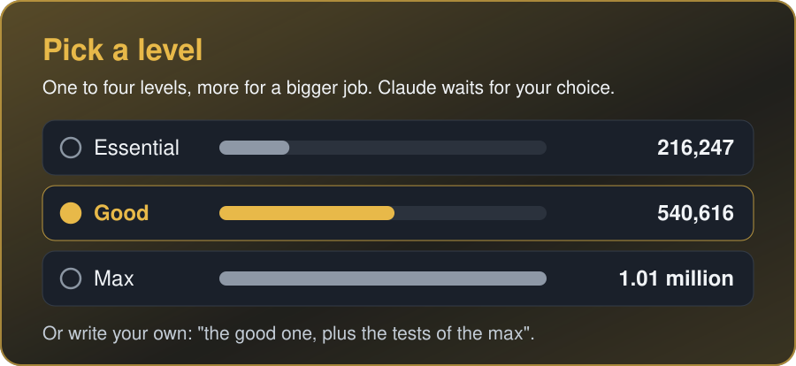

Above your threshold (300,000 weighted tokens by default) Claude does not start. Quotient works out the numbers of each level itself, so none is left out, and you can write a choice of your own in the free field.

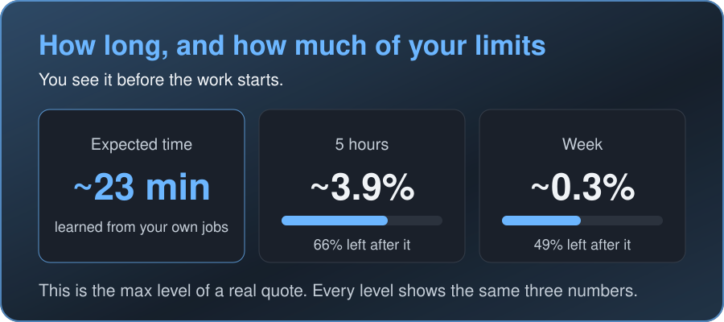

Each level says how long it should take and what it would leave of your limits. In the words of the first user, during two installments: "I know how long it takes, so I can step away from the computer."

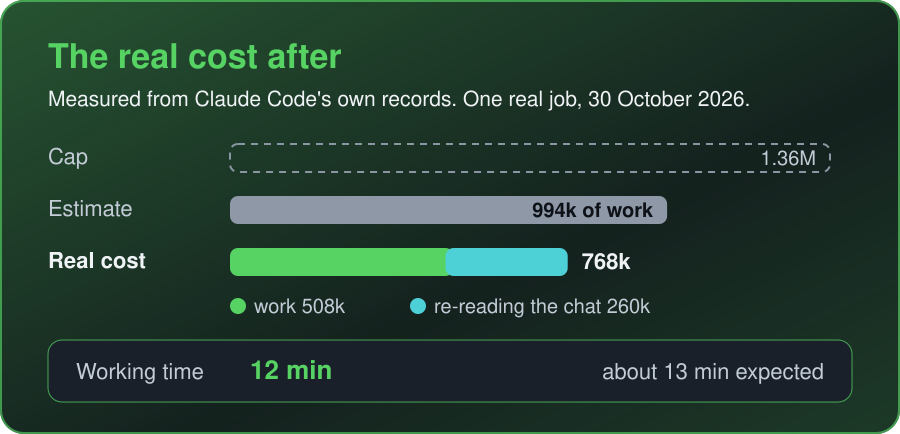

Claude tells you at your next message. The cost comes from Claude Code's own records, and the time counts only the work, without your turns.

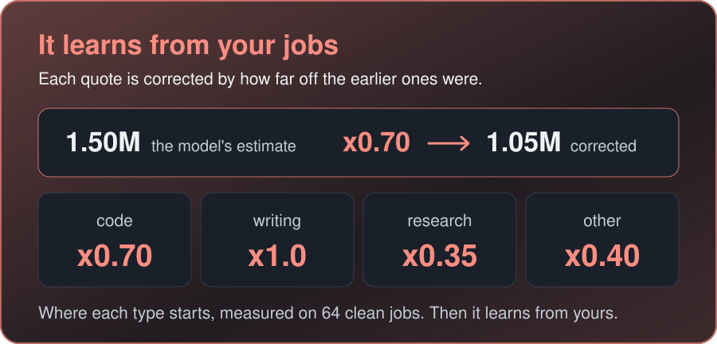

It learns only from clean jobs: chat jobs where you wrote nothing while Claude worked. Each type of work has its own factor, and until a type has 5 clean jobs it starts from the number in the picture.

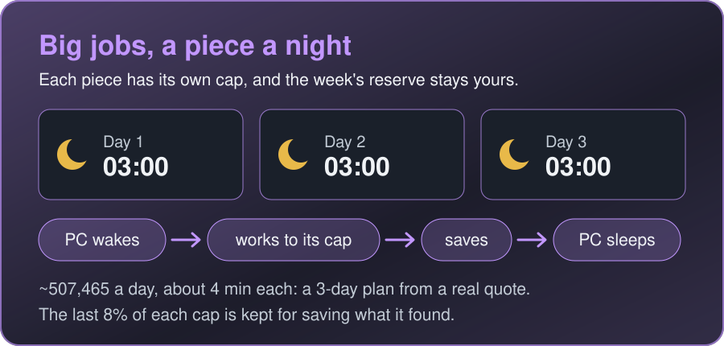

A notification and a report in the job's chat tell you what each piece did. Several jobs together never eat the share of the week you keep for yourself. Waking and sleeping work on Windows; on macOS and Linux Quotient gives you the line to schedule it yourself.

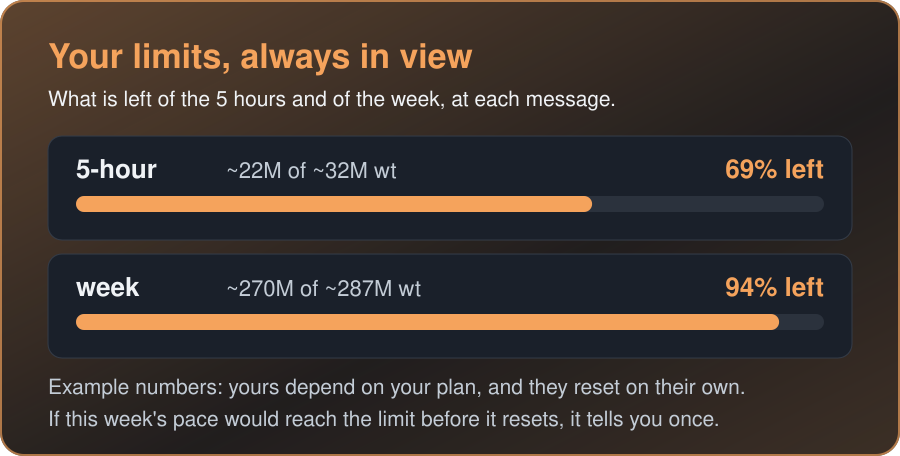

It can sit in Claude Code's status line (`setup-statusline --write`), and it works in the desktop app too. Anthropic does not publish the limits in tokens, so the token numbers are an estimate, measured on your PC or, until then, the shared size of your plan.

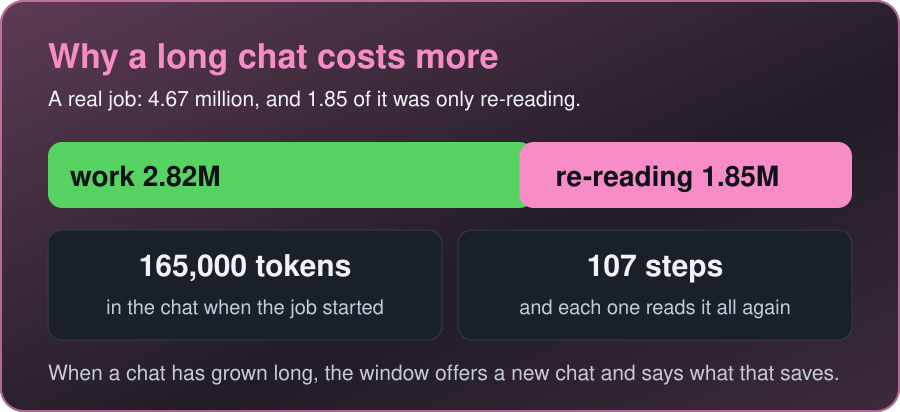

At every step Claude re-reads everything the chat holds. Quotient measures that apart from the work, and when a chat has grown long the window offers a new chat and says how much that saves.

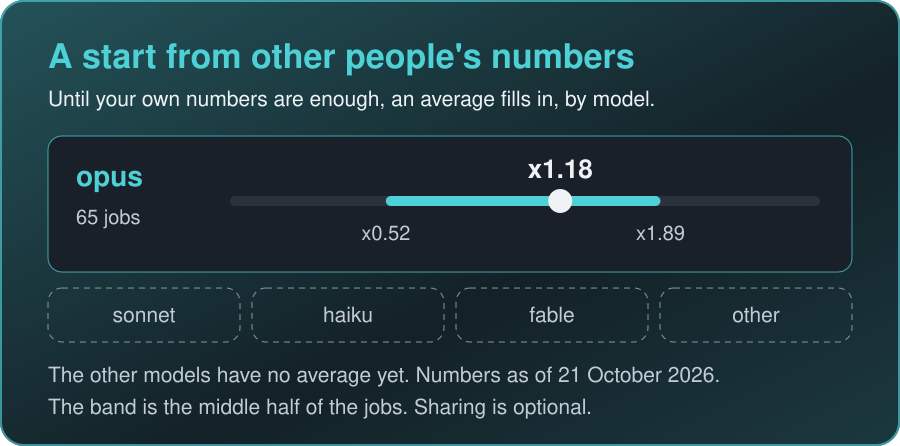

Copies of Quotient pool one line of numbers per finished job. The average fills in where you have no numbers yet: your first installments and the size of your plan's limits. Chat quotes start from the measured factors above. Since 1.2.3 it can also stay a small part of your factor (`shared_min_weight`), off by default.

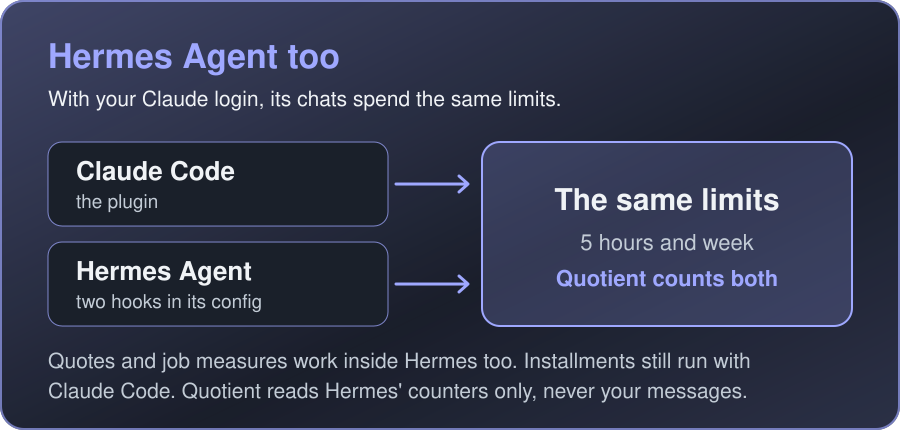

Two hooks in Hermes' config are enough, and only Claude chats count against the plan. The setup is under *More details*.

## Install

In Claude Code:

```
/plugin marketplace add Korvonordico/quotient-claude-tokens
/plugin install token-quotient@token-quotient
```

You need Python 3.8 or newer (standard library only, nothing else to install) and `sh`, which on Windows comes with Git for Windows, already used by Claude Code.

## Quick start

The first time, a window asks for four settings: from what size a job gets a quote, how much of the week to keep for yourself, the language, and whether Quotient may wake the PC for installments and put it back to sleep. A second window asks about the shared average and about long chats. Change them later with `/token-quotient:setup`.

Then work as usual. Under the threshold Claude just works; above it, or when you say "this is a big job", you get a quote first.

| Command | What it does |
|---|---|
| `/token-quotient:setup` | set Quotient up, or change its settings |
| `/token-quotient:report` | estimates against real costs, your limits, the weeks; `/token-quotient:report page` opens it as a page with charts |
| `/token-quotient:rate <job>` | split a big job into installments |
| `/token-quotient:share [on\|off]` | the shared average: exactly what is sent, and turning it on or off |
| `/token-quotient:help` | every command, with what it does |

Claude runs the other commands for you when you choose in the windows.

## How it works

1. You ask for something big, or you say "this is a big job".
2. Claude estimates the work of each level, and Quotient works out the rest. A window asks you for a level and a pace: all today, apart now in a separate session, or a plan in days.
3. The job runs and is measured. If what is left differs from the quote by more than 30%, Quotient makes a new quote of the rest, and Claude shows it to you once and asks whether to go on.
4. At the end you get the real cost and time next to the estimate, and the next quote learns from the difference.

Costs are in *weighted tokens*: input-token equivalents at the ratios of Anthropic's API prices (input 1, cache write 1.25, or 2 for the 1-hour cache, cache read 0.1, output 5). Estimates are not guaranteed: at the start they can be quite far off, and they get closer with each finished job.

## Privacy

Everything Quotient records stays on your computer, in `~/.quotient/` (or `QUOTIENT_HOME`). It reads Claude Code's transcripts for numbers: token counts, the machine lines Claude writes and the names of the tools Claude called. No text from your chats is ever sent anywhere.

One thing leaves your computer, and you can turn it off: after each finished job, one line of numbers for the shared average, exactly this:

```json
{"v":1,"q":"1.2.5","family":"opus","estimate":225000,"actual":259000,"plan":"max5","per_point":3220000,"per_point_5h":322000}
```

- No dates, no times, no names, no text, no paths, no session or user ids. The service that collects the lines ([code in `server/`](server/)) does not keep IP addresses.
- Turn it off with `/token-quotient:share off`, the plugin setting *Share anonymous numbers*, or `QUOTIENT_SHARE=0`. With sharing off you still get the shared average. `/token-quotient:share` shows exactly what is sent and how many lines are waiting.

Everything in detail: [PRIVACY.md](PRIVACY.md).

## More details

Nothing here is needed to start. Open what you want to know.

<details>
<summary><b>Why it exists, and the name</b></summary>

With a Claude subscription you pay for a job in usage limits: a 5-hour window and a weekly cap. Claude Code does not tell you what a job will cost before it starts, so you find out at the till. A big refactor or a long research task can hit the 5-hour limit halfway through, or use up most of your week.

Token Quotient (Quotient for short) gives you the price first, lets you choose, measures what the job really cost, and learns from the difference. Jobs too big for today can run in daily installments, at night if you like.

The name holds both halves: *quotient* starts like *quote*, the price agreed before a job, and in mathematics a quotient is the result of a division, like a big job divided into installments. *Token*, because that price is counted in tokens.

</details>

<details>
<summary><b>Everything it does</b></summary>

- **A quote before a big job.** Above a threshold you set (300,000 weighted tokens by default), Claude does not start. A choice window offers from 1 to 4 levels, more for a bigger job, each with what it includes, its estimated cost, its time and its share of your limits. Quotient works these numbers out itself, so none is left out. The free field is for your own choice, for example a mix of two levels.
- **You choose the pace.** All today, apart now (in a separate session, started at once), a plan in days with the amount per day and the time (longer plans for bigger jobs), or any pace you write yourself, such as "5 days at 2:00".
- **The real cost after**, read from Claude Code's own records and set next to the estimate.
- **How long, too.** Each level also says how long the job should take, learned from your own finished jobs. Quotient reads the time from what Claude Code and Hermes already record (no extra window), counts only the working time, and at the end sets the real time next to the expected one.
- **A new quote halfway.** A job is split into pieces, each a quarter of its corrected quote (at least 250,000 weighted tokens). At the end of each piece Claude writes how much is done. When what is left by that differs from the quote by more than 30%, Quotient makes a new quote of the rest, and Claude shows it to you once and asks whether to go on.
- **A correction factor.** Each quote is corrected by how far off the earlier ones were, learning only from clean jobs (chat jobs where you wrote nothing while Claude worked), with a factor of its own for each type of work. Until a type has 5 clean jobs, it starts from a factor for that type, measured on 64 clean jobs: code x0.70, writing x1.0, research x0.35, other x0.40.
- **Installments that work while you are away.** The PC wakes up, does the day's piece and goes back to sleep. A notification and a report in the job's chat tell you what it did.

It also:

- shows how much of the 5-hour and weekly limits you have used and what is left, and tells you once if this week's pace would reach the limit before it resets;
- plans the week as a whole, so several installment jobs together never eat the share of the week you keep for yourself;
- measures apart what Claude spends re-reading a long chat, and offers a new chat when that saves (see *Work and re-reading* below);
- measures a job as one job even when it moves from one chat to another;
- counts apart the replies about something else while a job runs: they are in the real cost, not in what the correction learns from;
- sets each finished job against how much the weekly limit rose, and tells you when the two do not match (see *How we check the measures* below);
- notices a job counted in two pieces, or a measure that does not match the week, and proposes the repair (`fix`), which Claude runs only with your yes;
- keeps the names of the plugins, MCP servers and hooks around each job, and shows the jobs before and after a change apart, so you can see what a plugin saves or costs; and says what other chats spent while a job ran;
- measures its own weight, so you can see what it costs next to what it helps;
- opens the report as a page with charts (`/token-quotient:report page`, a local file);
- has ready-made ways of working for long installment jobs: a book, a research, a code review (`rate templates`);
- works inside Hermes Agent too (see *Hermes Agent: setup and options*).

</details>

<details>
<summary><b>Installed it before version 0.9.8?</b></summary>

Installed it as `quotient@quotient`, before version 0.9.8? Remove that one first, then add the marketplace again: `/plugin uninstall quotient@quotient` and `/plugin marketplace remove quotient`. Your data in `~/.quotient` stays.

</details>

<details>
<summary><b>Hermes Agent: setup and options</b></summary>

If you also use [Hermes Agent](https://github.com/NousResearch/hermes-agent) with your Claude login, its chats spend the same 5-hour and weekly limits. Quotient can count them and quote jobs inside Hermes too.

1. Clone this repository in a folder where it can stay:

   ```
   git clone https://github.com/Korvonordico/quotient-claude-tokens
   ```

2. Add two shell hooks to Hermes' `config.yaml`, where `<path>` is the folder you cloned:

   ```yaml
   hooks:
     pre_llm_call:
       - command: "<path>/scripts/quotient.py hermes-hook"
     post_llm_call:
       - command: "<path>/scripts/quotient.py hermes-hook"
   ```

   On macOS and Linux Hermes runs the script directly, so make it executable: `chmod +x <path>/scripts/quotient.py`. Hermes asks you to approve each new hook once.

From then on Hermes gives Claude the quote protocol and the real limits at each message, measures quoted jobs from `CHOICE:` to `JOB: CLOSE` (their cost and their working time), and suggests `/compress` when a chat has grown so long that every step mostly re-reads it (at most twice per chat, a day apart). Quotient reads Hermes' token counters from its local session store, read-only: numbers, model and chat title. It never reads your messages; in a reply that gives a quote it also reads what Hermes wrote and the choices of its window, only to check that each level shows its time and shares (since 1.1.5 also the messages of the reply before the last one). Only Claude chats count against the plan. Since 1.1.4 it also counts Hermes' calls in the background (such as `background_review`), which Hermes keeps out of its chats' totals: on the author's data they were about 9% of Hermes' use. `quotient.py hermes` shows the Hermes numbers; `config hermes false` turns this off. Installments still run with Claude Code.

**Claude Code runs started from Hermes (optional).** A Hermes job often has Claude Code do part of the work (`claude -p`, directly or through a script), and Hermes' counters do not see those runs. To count them in the job, set `"claude_runs": 1` in `~/.quotient/config.json`. If Claude Code has the Quotient plugin (1.1.4 or newer), that is all; if not, add this SessionStart hook to Claude Code's `~/.claude/settings.json`:

```json
"hooks": {
  "SessionStart": [
    {"hooks": [{"type": "command", "command": "python",
                "args": ["<path>/scripts/quotient.py", "claude-link"], "timeout": 10}]}
  ]
}
```

Hermes gives every program it starts the id of its chat (`HERMES_SESSION_ID`). The hook writes one line per Claude Code session in `~/.quotient/claude-links.jsonl`: which Hermes chat started it, or none. When a job closes, Quotient adds what the sessions started by that chat spent while the job was open (their helpers included), and the report says how much of the cost they were; the factor learns from the whole, so the quote protocol asks to put those runs in the estimate. Installments are left out, since they measure themselves; scheduled tasks and the sessions you open yourself never count. With `"claude_runs_marker": "<text>"`, the `claude -p` sessions the hook never saw (from before it, or with your hooks off) also count when their first prompt starts with that text.

</details>

<details>
<summary><b>How a big job goes, step by step</b></summary>

1. You ask for something big, or you say "this is a big job".
2. Claude does not start. It estimates the work of each level and says what type of work it is (code, writing, research or other: each type learns its own correction), and Quotient works out the rest (`quote-table`): for each level the work, the re-reading of the chat, the total, the expected time and the share of the 5 hours and of the week, with what would be left. Claude shows that table as it is, then a window opens with two questions:
   - **Level**: how many levels goes with the size of the job. Up to about 300,000 weighted tokens one level; up to 1 million two (good, max); up to 5 million three (essential, good, max); above that four (essential, good, full, max). The sizes can be changed (`config levels.two 2000000`).
   - **Pace**: 4 options at most. With one or two levels: all today, apart now, 2 or 3 days. With three: all today, apart now, 3 or 5 days. With four: all today and plans of 3, 5 or 7 days (no "apart": one session would meet the 5-hour limit). When the chat is long, "in a new chat" comes after "all today" and the last option drops out. Each plan says the amount a day, the time (03:00 unless you set another, `config rate.time 02:00`), how long each installment takes and its share of the limits.
   - The window adds a **free field** by itself (Other). For the level, write a choice of your own, for example "the good one, plus the tests of the max": Claude estimates it and the job is measured against that estimate. For the pace, write how many days, how much a day and at what time, for example "5 days at 2:00" or "50,000 a day".
   If a quote reaches you without the time or the shares of a level, Quotient notices it at the end of the reply, and at your next message Claude says so and gives the quote again in full.
3. If you choose **all today**, Claude does the job. Quotient measures what it really cost and how long it took, and Claude tells you at your next message. If you write about something else while the job runs, Claude answers and that reply is counted apart: at the end you get work, messages in between and total. Writing during the job adds to its cost, and Claude says so after the choice. Past the first million weighted tokens, if the job's own pace says the rest will cost more than 30% more or less than the quote, Claude shows you a new quote of the rest once (cost, time, share of the limits) and asks whether to go on as planned, go on with a smaller level, or stop.
4. If you choose **apart, now**, the job starts at once as one installment in a separate Claude Code session, and its report comes back to the chat when it ends. Its measure is clean and the chat does not re-read it, but you cannot talk to it while it works: the task must be written well, it asks no questions halfway, and a command that needs a permission may stop it. From Hermes too, it runs with Claude Code.
5. If you choose **installments**, a second window asks when the first one starts and, if the pace did not already say it, at what time the next ones run.

Estimates are not guaranteed: at the start they can be quite far off, and they get closer with each finished job. If a reply costs more than the threshold and had no quote, Quotient tells you once, in one line, and counts it in the report.

Costs are in *weighted tokens*: input-token equivalents at the ratios of Anthropic's API prices (input 1, cache write 1.25, or 2 for the 1-hour cache, cache read 0.1, output 5).

</details>

<details>
<summary><b>Commands from a terminal</b></summary>

Run them as `python scripts/quotient.py <command>` from the plugin's folder or a clone of this repository.

| Command | What it does |
|---|---|
| `report [--html]` | the report (`--html`: a page with charts, opened in the browser) |
| `setup --threshold N --reserve N --lang it\|en --after sleep\|hibernate\|nothing` | save the settings (also `--wake yes\|no` and `--share yes\|no`) |
| `setup --compact keep\|auto\|<tokens>` | long chats: keep them as they are, or let them compact themselves at a size |
| `setup --hermes-copy yes\|no` | Hermes: save the whole chat to `~/.quotient/chats/` before each automatic summary |
| `config [key [value]]` | show every setting, or change one |
| `share status\|on\|off\|send` | sharing, from a terminal (`send`: send the waiting lines now) |
| `export` | the exact line sharing sends for each finished job |
| `quote-table --raw essential=N good=N max=N [--kind rate] [--type code\|writing\|research\|other] [--lang it\|en]` | the quote worked out by Quotient: every number of each level (time, share of the 5 hours and of the week) and the pace options; Claude runs it and copies the table |
| `fix [list]`, `fix merge <a> <b>`, `fix exclude <job> [--why ...]`, `fix chat <job>`, `fix undo` | the guided repair: what looks wrong in the measures; join a job counted in two pieces; take a wrong measure out of the factor; work out again the chat part of a job whose chat was compressed while it ran; take the last repair back. A copy of `jobs.jsonl` comes first and nothing is deleted |
| `timer start --raw N [--level L]`, `timer show`, `timer stop` | the stopwatch of a quoted job: Claude starts it when the work begins; `stop` hides the window until the next job |
| `backfill-time` | work out the time of jobs measured before 1.1.0 from their logs (Quotient does it by itself once) |
| `setup-statusline [--write]` | show the plan limits in the status line |
| `plan-changed [--undo] [--plan pro\|max5\|max20\|other\|unknown]` | you changed subscription: Quotient learns the size of your limits again from now (`--undo`: take the last change back; `--plan`: the new plan) |
| `telemetry [status\|on\|off] [--write]` | Claude Code's own telemetry as a second measure, kept on this PC: `on` prints the settings, `--write` puts them in `~/.claude/settings.json` (a copy first) |
| `hermes` | Hermes Agent chats: read its token counters now |
| `tick` | read Hermes' counters and the plan limits now (for a scheduled task) |
| `rate new <job> --dir <folder> --task-file <file> --quote N (--days N \| --daily N \| --pace "5 days at 2:00") [--at HH:MM] [--template book\|research\|code-review] [--type code\|writing\|research\|other]` | create a job in installments (`--pace`: your own words, with the days, the amount a day and the time) |
| `rate templates` | the ready-made ways of working: book, research, code review |
| `rate apart <job> --dir <folder> --task-file <file> --quote N [--type ...]` | do a job apart, now: one installment in a separate session, started at once; its report comes back to the chat |
| `rate run <job> [--force]` | run one installment now (`--force`: even if one already ran today) |
| `rate once <job> [--time HH:MM]` | one installment at that time (tomorrow if it has passed; without `--time`, the job's own time); wakes the PC |
| `rate schedule <job> [--time HH:MM] [--force]` | one installment every day at that time (without `--time`: the job's time, else 03:00); wakes the PC |
| `rate after <job> sleep\|hibernate\|nothing` | what the PC does after each installment, if nobody uses it |
| `rate here <job>` | each installment's report comes to this chat |
| `rate week` | all open jobs against what is left of the week |
| `rate set <job> --daily N --per-day N --days N` | change a job: size of each installment, how many a day, how many in all |
| `rate pause <job>`, `rate resume <job>` | pause a job, or start it again |
| `rate stop <job>` | stop a job and remove its scheduled runs |
| `rate status [job]` | installments done and weighted tokens spent |
| `rate check [--live]` | can a scheduled installment wake this PC, and is Claude Code logged in (`--live`: one real call, a few cents) |

</details>

<details>
<summary><b>How installments work</b></summary>

You leave the PC in sleep or hibernation, as you always do. Every installment then goes like this:

1. **At the time you chose** (for example 03:00), Windows wakes the PC.
2. **Quotient starts Claude Code** in the background, without opening the app. Claude reads the job and a short note of where it stopped last time.
3. **Claude works on the next piece** until it reaches that day's amount. Then it writes down where it stopped, and stops cleanly.
4. **When nobody is using the PC** (no keyboard or mouse for 10 minutes), Quotient puts it back to sleep, or into hibernation if you chose that, whoever turned it on. A notification comes first: move the mouse within 2 minutes and the PC stays on. If you are using the PC, Quotient waits until you stop, for up to 6 hours.
5. **The next day, at the same time, it starts again**, until the job is finished. Then the schedule removes itself.

When you come back, Windows has shown a notification for each installment, which stays in the notification center; a click opens a page with that installment's report (kept in the job's folder, under `reports`). The full report waits in the chat where you created the job and appears at your first message there: which installment, when, what it cost against the day's amount and the week, what it did, what is left and when the next one starts. Other chats tell you once, and a second time no sooner than a day later; then they stop. To get the reports in another chat, ask Claude there (`rate here <job>`).

Good to know:

- **Each installment pays its start (1.2.2).** It is a new Claude Code session: before any work it reads its rules and tools, about 100,000 weighted tokens on the author's PC. Quotient counts that once per installment in the quote, and never sets a cap under 1.5 times it, so an installment never spends its whole cap just starting.
- If you prefer that Quotient never touches the PC, choose so in the setup: installments then run only when the PC is already on.
- A timer can wake a PC that is asleep or hibernated, not one that is shut down. If the PC was off, the installment runs as soon as you turn it on.
- Windows must allow wake timers. `rate check` tells you whether it does, and how to turn them on.
- If you use the Claude desktop app, log in Claude Code once in a terminal (`claude auth login`): installments run outside the app. That login can expire: while an installment job is open, Quotient checks it every 6 hours on your messages (at no cost) and tells you in the chat, so you can renew it before the night. `rate check --live` makes one real call with the smallest model to be sure (a few cents). An installment that stops for the login spends nothing, and its notification says what to do.
- You can start one more installment the same day, if you accept that it uses more of that day's limit.
- If, at the end of an installment, the installments' own pace says the rest will cost more than 30% above the plan, the notification and the report give the new numbers (what is left, how many more installments, share of the week, time) and ask whether to go on, make the installments bigger, or stop.
- The last part of each installment's cap (8%, `config rate.save_percent`) is kept for saving: there Quotient refuses what starts new work (helpers, web searches, commands) and lets Write and Edit through, so the installment and its helpers save what they found. Installments save as they go, and their helpers write their results to files. If one stops anyway, its handoff lists its helpers' files and what they did, so the next one takes them up instead of doing them again.
- Waking and sleeping work on Windows. On macOS and Linux Quotient gives you the line to schedule it yourself.

</details>

<details>
<summary><b>The week: all jobs together</b></summary>

Two or three jobs can each fit in the week and still not fit together. Quotient adds up every planned installment until the weekly limit resets and keeps a reserve for your normal use (20% unless you change it). If the plan does not fit, a window asks which jobs to keep, slow down or pause. An installment never eats into the reserve: it gets smaller, or waits.

</details>

<details>
<summary><b>Your limits</b></summary>

Quotient records how much of the 5-hour and weekly limits you have used and when they reset, and can show it in Claude Code's status line (`setup-statusline --write`):

```
Quotient · 5-hour: 31% used, 69% left (~22M of ~32M wt), resets 19:30 · week: 6% used, 94% left (~270M of ~287M wt), resets Mon 12 07:00
```

It takes these numbers from what Claude Code passes to the status line, and also from Claude Code's own `/usage` command, run in the background with no tokens spent (at most every minute since 1.1.8, every 10 minutes before; off with `config limits.live false`). So the limits are there in the Claude desktop app too, where there is no status line. `tick` reads them now, for a scheduled task.

Over time it also estimates how many tokens 1% of each limit holds, so a quote can say "this takes about 8% of your week". Anthropic does not publish the limits in tokens, so this is an estimate, with its margin.

Since 1.1.8 the line also says how many weighted tokens are left in each limit (`~22M wt` above): the share left times how much 1% holds, measured on your PC or, until then, the shared size of your plan. It falls as you use the limit, and the quotes use the same sizes. It is rounded because it is an estimate; it shows up once a size is known. Off with `config limits.show_left 0`. Since 1.2.0 the line also says the ceiling, `~22M of ~32M wt` (100 times how much 1% holds), so the number falls toward zero of a whole you can see; `config limits.show_top 0` leaves the tokens left alone.

**The work in pieces (1.2.1).** A job is measured in pieces, each with a `PROGRESS: n%` line: in a chat a piece is a quarter of the corrected quote (at least 250,000 weighted tokens; before, it was always one million, so most jobs had none), and an installment records its handoff's `PROGRESS` line each time the agent updates it, so a 2-3 million installment is no longer one piece. The whole job is worked out again at each piece (cost so far divided by the progress). In a real test paid with API credits, one installment of 265,000 weighted tokens recorded 6 pieces, and the estimate of the whole job went 617k, 450k, 383k, 344k, 332k, 323k as it went. `config piece_share 0` brings back the old pieces.

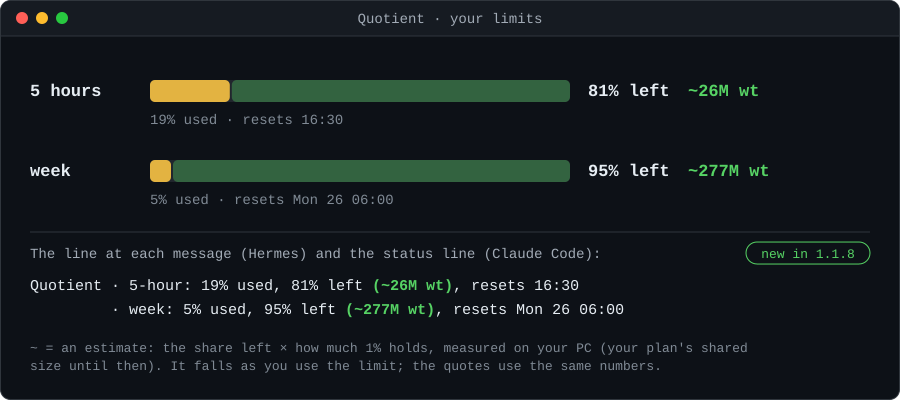

*The numbers in the picture come from the author's Max 5x plan on 19/10/2026: yours depend on your plan. Anthropic does not publish the limits in tokens and can change them at any time without notice (it doubled Claude Code's 5-hour limits on 6 May 2026), so Quotient keeps measuring them.*

**Learned for your plan.** Each user learns the size of their own limits, on their own PC, from their own readings: Pro, Max and the other plans have different limits, and no size is assumed or shared. Heavier models (Opus more than Sonnet) spend the limits faster for the same tokens, so the estimate also moves with the models you use.

**The week checked against the 5 hours (1.1.2).** The week rises slowly, so its own estimate has few points. Both percentages rise with the same use, though: within one 5-hour window and one week, Quotient sets how many points the 5 hours rose against how many points the week rose. That ratio, times the size of 1% of the 5 hours (which has many points), is a second estimate of the week. The report shows the two side by side and says when they are more than 1.5 times apart (`config ratio.factor`). When the week's own estimate has fewer than 3 points and the ratio has them, the ratio is used in its place, and the report says so. The percentages are whole numbers, so the ratio has a margin too.

**If you change plan (1.1.2).** Quotient works out the size of each window. When the last three 5-hour windows, on more than one day, are all more than 1.6 times away from the earlier ones in the same direction (`config plan.factor`), and the week in the same time is too, it takes it as a change of plan: from the start of those windows on it learns only from the new readings, writes the change in `plan-changes.jsonl`, and Claude tells you once: your limit seems to have changed, maybe you changed subscription, Quotient starts learning it again. A day of heavy use outside Quotient (claude.ai, the phone) makes the limit look smaller for a while, which is why one far window, or one day, is not enough; days on a heavier model can look like a smaller plan too. You can also say it yourself: `plan-changed` starts learning again from now (until the week has points of its own, it is estimated from the ratio with the 5 hours, and the report says so), and `plan-changed --undo` takes the last change back if there was none.

</details>

<details>
<summary><b>The time of a job</b></summary>

A quote also says how long each level should take. Quotient measures the **working time** of every quoted job: the time Claude works, without your turns (from the end of a reply to your next message) and without the wait of the choice window. From your last 20 finished jobs it learns how many minutes a million weighted tokens of work take (the median), installments apart, and the expected time of a level is its corrected work times that. Like the correction factor, it gets closer with every job. Jobs measured before 1.1.0 get their time once from their logs: the chat's transcript, Hermes' message times, the installments' start and end.

In the words of its first user, during two installments: "I know how long it takes, so I can step away from the computer."

Claude marks the start of the work right after the choice (`timer start`). After the first million weighted tokens (`config requote.after`), at each of your messages Quotient also looks at the job's own pace, and Claude writes a `PROGRESS: <n>%` line. When the rest by that line differs from the rest of the quote by more than 30% (`config requote.percent`), Quotient makes a new quote, once per job, and Claude shows it to you at your next message. The job keeps it, and at the end the closing line says how near it came to the real cost: the report lists these new quotes, so you can see whether they are worth it.

The time is in Claude Code's status line. A small always-on-top stopwatch window exists too, off by default (`config timer.window true`; it needs Python's tkinter). At your next message Claude tells you the job's real cost and time against the expected ones. Each installment's report and notification say how long it worked, and `rate new` says how long each installment should take.

</details>

<details>
<summary><b>Work and re-reading: why a long chat costs more</b></summary>

At every step (every call to the model) Claude re-reads everything the chat holds: the system, the tools, your rules, the conversation so far. Each re-read token costs little (a tenth of a new one, thanks to the cache), but it adds up. In a chat that starts with 165,000 tokens, every step costs about 16,500 weighted tokens before any work is done; a job of 100 steps, about 1.65 million. A model estimating a job thinks of the work, not of this.

So Quotient splits every job it measures in two:

- **work**: the steps of the job itself. The estimate is about this, and the correction is learned from it.
- **re-reading**: what the chat already held when the job started, read again at every step. Quotient measures it, and in a quote adds it from the size of the chat now and the steps the work will take.

A real case, 6 October 2026: a job cost 4.67 million weighted tokens, of which 2.82 million work and 1.85 million re-reading the 165,000 tokens the chat started with, over 107 steps.

When a chat has grown long, the window also offers to do the job **in a new chat**, and says how much that saves. You open a new chat and ask to continue: Quotient tells the new chat that a job is waiting, and measures it there.

</details>

<details>
<summary><b>Long chats: keep them, or let them compact themselves</b></summary>

A plugin cannot run `/compact`, but Claude Code can summarize a chat by itself when it reaches a size. In the setup you choose one of three:

- **Keep the chat as it is** (the default). Quotient does not touch compaction; when a chat has grown long, the window offers a new chat.
- **Let it compact itself at the size Quotient recommends**: where re-reading the chat at every call costs about twice the work of a call, from your own numbers (about 600,000 tokens at the start).
- **At a size you choose**, from 100,000 to 1,000,000 tokens.

For the last two, Quotient writes `autoCompactWindow` in `~/.claude/settings.json`, and takes its own value back if you return to the first (a value you had set yourself is put back). A summary loses some details: when the chat gets close to the size, Quotient tells Claude once to save to files what must not be lost. Each compaction is measured, and the report says what it saved. Change it any time with `/token-quotient:setup` or in the plugin settings.

</details>

<details>
<summary><b>Types of work, changes around Claude, and repairs (1.1.4)</b></summary>

- **Types of work.** Code, writing and web research go wrong in different ways: on 15 October 2026 a check of a book's facts with web searches was estimated at 1.6 million weighted tokens and cost 4.4 million. The QUOTE line carries a type (`kind=code|writing|research|other`). A type uses its own factor once it has 3 finished jobs (`config type_min_jobs`), the general one before. The report shows each type's factor with how many jobs it has. Jobs from before 1.1.4 count as `other`.
- **Changes around Claude.** Each finished job and each installment keeps the names of what was around it: Claude Code's enabled plugins, MCP servers and hooks, and Hermes' (names only: never a command line, a setting or a secret). When they change, Claude tells you once, and the report shows the jobs before and after the change apart (factor, and cost of 1 million weighted tokens of work). Once 3 jobs finished after the change, they count twice in the factor (`config env.min_jobs`, `env.weight`).
- **Work done elsewhere.** Each job and installment records what other chats (Claude Code, installments, Hermes) spent while it ran. When that is at least 50,000 weighted tokens and 5% of the job, the closing line and the installment report say it: it is not in the job's cost, but it is in your limits.
- **Repairs.** `fix list` shows what looks wrong: a small job that ended at most 30 minutes before another of the same chat started (probably one job counted in two pieces), the measures that do not match the week, and the jobs whose chat was compressed while they ran, measured before that was counted. `fix merge` joins two jobs, `fix exclude` takes a job out of the factor, `fix chat` works out again a job's chat part, `fix undo` takes the last repair back. Each one copies `jobs.jsonl` first (in `~/.quotient/fix/`), keeps what it takes out in `jobs-excluded.jsonl`, and writes the factor before and after in `fix.jsonl`. Claude proposes the command when Quotient finds a problem, and runs it only with your yes.

</details>

<details>
<summary><b>Second measures, your plan, and packages of work (1.1.6)</b></summary>

- **Claude Code's own telemetry** (off by default). `telemetry on` prints the lines for the `env` block of `~/.claude/settings.json`; `telemetry on --write` puts them there after a copy of the file. Claude Code then sends its own token and cost counters to a small receiver on this PC (`127.0.0.1:4318`), which keeps numbers only in `~/.quotient/otel.jsonl` and stops by itself after 2 hours without data. Each finished job and installment is set against it: when the two measures differ by more than 25%, Claude tells you once, and the report shows the comparison and the calls on the side (titles, summaries) only the telemetry sees. Nothing changes by itself.
- **The costs others work out.** Hermes' own cost estimate, Claude Code's cost of each installment and, when the status line is on, the cost of the session are set against the weighted tokens in the report, with the prices they imply. On the author's data a cache read costs 0.05 x input, not the 0.1 x Quotient weighs: the report shows it, and `config weights.cache_read 0.05` is your choice.
- **The limits read every minute during a job** (`config limits.job_every`, in the background): more points, so the size of your limit is learned in fewer uses. The percentages are whole numbers (checked on 254 readings), so each window keeps a margin of one point.
- **Your plan.** The setup window asks it (Pro, Max 5x, Max 20x, other, I don't know; `setup --plan`, `plan-changed --plan`). Until your own readings are enough, Quotient starts from the shared size of 1% of the week and (1.1.7) of 1% of the 5 hours of your plan, said as an estimate with its margin.
- **Packages.** Past each million of work the agent writes `PROGRESS: n%`; the whole job is then the cost so far divided by the progress (the time likewise), with a margin that narrows at each package. Each installment is a package. When a job closes, Quotient keeps how wrong the PROGRESS lines were, and that becomes the margin of the next jobs.

</details>

<details>
<summary><b>How the correction learns: optional settings and what each version changed</b></summary>

**Which jobs teach the factor, and medium quotes (optional).** Small jobs are noise for the factor, and a job that seems to do millions of weighted tokens in a few minutes is a measuring error. In `~/.quotient/config.json`: `"learn_min_raw": <n>` leaves out the chat jobs quoted under n wt (installments always count); `"learn_max_speed": <n>` leaves out the jobs whose work ran faster than n wt a second (a usual pace is about 1,000); `"learn_mid_min": <n>` gives the chat jobs quoted from n up to `learn_min_raw` a factor of their own, used for every quote under `learn_min_raw`; from `learn_min_raw` up to `"learn_blend_raw": <n>` (3,400,000 by default) the estimate is corrected along a straight line, from `learn_min_raw` x that factor to n x the main one, and from n up by the main factor alone: there is no jump at either end, a bigger level always comes out bigger, and big jobs go back to their own factor (with the author's numbers, 1.1 million comes out 1.82 million, 1.6 million 2.17 million, 3 million 3.17 million and 5 million 5.08 million, the factor alone; before 1.1.7 1.1 and 1.6 million both came out 1.75 million). If the factors change so much that the line would rise less than half as fast as the main factor, Quotient makes it longer by itself. The first three are off (0) by default; the author uses 1,000,000, 3,000 and 500,000.

**Installments learn from all your jobs (optional, off by default).** With `"learn_rate_all": 1` the installments' factor is learned from your last `history_window` finished jobs of both kinds, chat jobs and installments, without `learn_min_raw`, `learn_max_speed` and the types of work; the chat jobs' factor does not change. On the author's 51 jobs (16/10/2026, a walk-forward test: each job estimated only with the jobs finished before it) the installments' typical miss went from 48% to 34%, and their estimates no longer fell under the real cost by x1.41 but by x1.06: learned from installments alone, the factor came from a few big book jobs that cost less than quoted, and was applied to smaller jobs that cost more. Only 13 installments: a hint, not a proof. Turn it on with `config learn_rate_all 1` and off with `config learn_rate_all 0`; the report says which of the two rules the installments use.

**What 1.1.9 changes in the learning.** On 19/10/2026 the author's 58 measured jobs showed where the misses came from: a job where the user wrote nothing during the work cost about x0.56 its raw quote, while a job where the user added tasks halfway cost about x1.49. One factor learned from both was too low for some jobs and too high for the others. Now the chat jobs' factor learns only from those clean jobs (`learn_clean_only`), a new user starts from x0.58, what the 49 clean jobs of [docs/evidence](docs/evidence/quote-accuracy.md) really cost against their quotes (`start_factor`), and a task added during a job gets a quote of its own (`requote_on_addition`, now on), so each quote stays about the job it was made for. A quote with its type of work starts from that type (code x0.70, research x0.35, other x0.58; texts by the rule for texts, now on at 27 weighted tokens per final word). Checked on new tasks done as a new user and paid with API credits: typical miss 22% on 42 new tasks against about 120% with 1.1.8 ([the numbers](docs/evidence/quote-accuracy.md#119-new-tasks-paid-with-api-credits-19-october-2026)). On the author's clean jobs the typical miss went from 60% to 43% (walk-forward, 11 jobs: a hint, not a proof); with a learned factor the 49 test jobs were within 33% on the median. A quote is still an estimate: a job that grows while it runs costs more than its first quote.

**What nine measured jobs taught (1.1.8, each off by default).** On 16/10/2026 nine small jobs (code, texts, one web research) were each done in a new Claude Code session, as a new user, with nothing added halfway, and their real cost was set against the quote. Five settings came out of it; each one is off (0) until you set it with `config <key> <value>`.

- **The rule for texts** (`writing_wt_per_word`, 50 suggested). The texts were quoted about 4 times under their cost: the quotes counted 10 to 19 weighted tokens per word of the final text, the real cost was 49 to 56. A text comes out as output (weight 5, about 6.5 tokens a word through the Write tool), then goes back into the chat and is re-read at every call after it. With the key on, the quote protocol tells Claude to count that many weighted tokens per final word (with a margin from half of it to 1.1 times: 25 to 55 for 50), and `quote-table --words <n>` shows what the rule gives; an estimate under the margin is made again before anything is shown. With 50, the article of 881 words would have been quoted at about 44,000 (it cost 49,571) and the guide of 5,073 words at about 254,000 (it cost 257,043). But on 17/10/2026, with the rule on, 13 more texts cost 23 to 49 per word (about 28 on average), so 50 quoted them about 1.7 times above their cost: over all 16 texts about 32 per word, and a value of 30 to 35 may fit better ([the measures](docs/evidence/quote-accuracy.md)).
- **Web searches use a second model** (`note_web_haiku`, 1 = on). Claude Code's web searches also run a small model (haiku), which is not in the session's log, so Quotient cannot measure it: on the one research job measured it was about 12% of the session at list prices. With the key on, the report at the end of a research job (or of a job that searched the web, with how many searches) says so in one line.
- **One line for a small job** (`small_quote_line`, 1 = on). In a new session the full quote (the table, the choice window, the first-use questions) cost about 70,000 weighted tokens, more than many small jobs. With the key on, a quote you ask for a job under the threshold is one line (work, chat part, total, time, shares of the limits), and the first-use questions wait for the first job above the threshold. A one-line quote often gets a plain yes: when the reply after it does the work and ends with a `JOB:` line but no choice, the quote's one level counts as chosen, so the job is still measured (in the tests of 17/10/2026 one job of 22 went unmeasured that way).
- **The margin** (`margin_percent`, 15 suggested). The same job done again cost from 9% less to 10% more, and the quote of the same task changed too. With the key on, at the end of a job a miss under that many percent is said to be within the margin: noise, not a signal.
- **A quote for what you add** (`requote_on_addition`, 1 = on). In the author's jobs, those with signs of tasks added halfway cost 1.82 times their raw quote, the others 1.20 times, and a new quote made halfway came within x0.84 to x1.14 of the real cost. With the key on, the protocol says that a task added to a job, while it is open or right after it, gets a quote of its own before it is done: the new quote closes the job so far, and the addition is measured against its own estimate. The line of the open job reminds it only at the job's first message.

**A chat compressed in the middle of a job.** From then on each step re-reads less of what the chat held: Quotient counts that (Hermes reply by reply, Claude Code call by call). `fix list` finds the jobs measured before this was counted, and `fix chat <job>` works them out again (a copy first; `fix undo` takes it back).

</details>

<details>
<summary><b>What is shared, in detail</b></summary>

- `plan` only if you chose your plan; `per_point` and `per_point_5h` (how many weighted tokens 1% of your week and 1% of your 5 hours hold, 3 digits) only when Quotient has learned them from your own readings.
- Quotient also downloads the shared average once a day, and reads your plan usage from Anthropic with Claude Code's own login (details below).

Each copy of Quotient learns from its own errors, but a new user has no errors yet. So the copies pool their numbers. The line holds the format, the Quotient version, the model family (opus, sonnet, haiku, fable or other), the raw estimate and the real cost of the work in weighted tokens (from 0.9.5 without the re-reading of the chat, which the estimate is not about), rounded to 3 significant digits; from 1.1.6 also your plan, if you chose it, and the size of 1% of your week learned on your PC, and from 1.1.7 the size of 1% of your 5 hours, so a new user of the same plan starts from the average of that plan and other people confirm the limits of each plan. It leaves at the start of your next session, never in the middle of a reply, and nothing is queued before Claude Code has shown you a message about it.

- The service does not keep IP addresses: its code never reads them and request logs are off.
- At most once a week, after at least 20 new jobs and never below 30 jobs in all, it publishes the average in its own repository, [quotient-data](https://github.com/Korvonordico/quotient-data) (the service's key can write only there, never in this code). Every copy of Quotient downloads that file once a day and uses it only between x0.25 and x4: anyone can send numbers, so it is a best-effort average.
- The size of 1% of the week and of the 5 hours of a plan is **an estimate to start from, taken from other users**, with its margin (the middle half of them), not a certainty: Anthropic does not publish the limits in tokens, how much each message takes depends on the model and the length of the chat, and Anthropic changes them (on 6 May 2026 it doubled Claude Code's 5-hour limits). Each window of a plan is published only from 30 jobs, and as soon as your own readings are enough Quotient uses those instead.
- The first-use window asks whether you take part (yes by default), and you can change it any time.

</details>

<details>
<summary><b>Everything Quotient runs, sends and fetches</b></summary>

- **On your computer, always**: its Python script, through `sh`, at the start of each session, at each message, at the end of each reply, before a compaction, and before each tool call inside an installment. It reads Claude Code's transcripts of your chats for numbers: the token counts of each call, the machine lines Claude writes, and which tools Claude called (to measure the cost and Quotient's own weight); in a reply that gives a quote, also what Claude wrote and the options of the choice window, to check that each level shows its time and shares. At the end of an installment that stopped with helpers, it also reads each helper's short description and looks for its own refusal message in their transcripts, to list them in the job's handoff. No text from them is ever sent anywhere.
- **It writes** only in `~/.quotient/` (or `QUOTIENT_HOME`), plus a report page for each installment in the job's own folder. The two exceptions touch `~/.claude/settings.json`, and only when you choose them: `setup-statusline --write` puts the status line there, and the long-chat choice "compact" writes `autoCompactWindow` there (taken back when you choose "keep" again).
- **For installments, only after you choose them in the window**: Windows Task Scheduler tasks (`schtasks`) that run at the time you chose and, if you allow it, wake the PC; Claude Code itself (`claude -p`) in the job's folder, with the permission mode `acceptEdits`, no permission prompts, and only the tools you allow in `rate.extra_args`; PowerShell for the notification and to read when the next installment runs; sleep or hibernation afterwards, if you chose so and nobody is using the PC. `rate check` reads (never changes) the wake-timer setting with `powercfg`.
- **It runs Claude Code's own `/usage` command** to read your plan usage: Claude Code answers it locally, with its own login, and Quotient keeps only the percentages and the reset times. At most every minute (since 1.1.8; every 10 minutes before, except while a job or an installment was open), always in the background, so no message waits for it (since 1.1.7), with no tokens spent; Quotient never reads your login. Off with `config limits.live false`.
- **Claude Code's telemetry, only if you turn it on** (`telemetry on`): a receiver of its own on `127.0.0.1` (port 4318, this PC only) keeps the numbers of Claude Code's token and cost counters in `~/.quotient/otel.jsonl` and drops everything else (e-mail, account ids). `telemetry on --write` and `telemetry off --write` change the `env` block of `~/.claude/settings.json`, after a copy of it.
- **The status line**, if you set it up, also keeps the session's cost Claude Code gives it (`statusline-cost.jsonl`, numbers only).
- **With Hermes Agent**, it reads Hermes' local session store, read-only: token counters (also those of its calls in the background), model and chat title, and, for the working time of a quoted job, when each message was written and by whom; in a reply that gives a quote, also what Hermes wrote in it and the choices of its clarify window, only to check the quote (1.1.5). It never reads your messages.
- **The names around a job** (1.1.4): at the end of each job and installment it reads Claude Code's settings (`settings.json`, `settings.local.json`, `~/.claude.json`, the folder's `.mcp.json`) and Hermes' `config.yaml` for the names of the enabled plugins, the MCP servers and the scripts the hooks run, and the cache Hermes uses. It keeps the names only, in `~/.quotient/env.jsonl`; never a command line, a setting or a secret, and nothing is sent.
- **The stopwatch window**, only if you turn it on (`config timer.window true`): a small window of its own (Python's tkinter) that only reads `~/.quotient/timer.json`.
- **It sends**, unless sharing is off: one line of numbers per finished job to `https://quotient-share.korvonordico.workers.dev`.
- **It fetches**, once a day: `https://raw.githubusercontent.com/Korvonordico/quotient-data/main/average.json`, or the service's `/v1/average` when GitHub does not answer. Both belong to the author.
- **The page with charts** is a file, `~/.quotient/report.html`, opened in your browser; it loads nothing from the internet.

</details>

<details>
<summary><b>How accurate are the quotes</b></summary>

50 jobs done on purpose in fresh Claude Code sessions, as a new user (16 and 17 October 2026: code, bug fixes, texts, web research, additions halfway, jobs done twice), each with its quote and its measured cost: [docs/evidence/quote-accuracy.md](docs/evidence/quote-accuracy.md), with every number in [results.json](docs/evidence/results.json). In short: the model's quotes were mostly too high (the work came to 0.58 times the raw quote on average); close for new code (x0.86), about twice too high for bug fixes, 2.5 times too high for web research; texts were 4 times too low without the rule for texts, and about 1.7 times too high with it at 50 per word. The same job done again cost within ±10% in 13 of 21 pairs. These are small jobs, not the long ones of real use: the page says what the numbers do not show.

</details>

<details>
<summary><b>How we check the measures</b></summary>

The correction learns from the measures: if the measures are wrong, it learns the wrong thing. This is how Quotient checks them, and what is not shown yet.

- **Automatic tests.** 444 tests run at every change, on Windows and Ubuntu with Python 3.9 and 3.13, on made-up chats whose costs are known in advance: each API call counted once, the chat part, the working time, jobs that move between chats, installments, Hermes.
- **Errors found and fixed.** In 1.0.0 the jobs measured in Hermes turned out to be 57 pieces of 4 real jobs: the agent wrote its quote again at every message, and each copy opened a new job. The correction factor had fallen to x0.14. The cause is fixed; the pieces already made were not repaired automatically. On 15/10/2026 a piece of a job was found counted apart from it, and it was put back by hand; since 1.1.4 Quotient finds such cases itself and proposes `fix`.
- **The measures against the week (1.1.1).** Anthropic shows the share of the weekly limit used, and Quotient estimates how many weighted tokens 1% holds. Each finished job and each installment is set against how much the week rose in the same time. If the two are more than 3 times apart (`config check.factor`) and no other job was running, Claude tells you once that the measure of that job does not match the week, and the report lists it. Quotient changes nothing by itself. Jobs under 4 points of the week are not judged, because the percentages are whole numbers. Other chats, and use Quotient cannot see (claude.ai, the phone), move the week too: a warning is a hint to check, not a proof.
- **The week against the 5 hours (1.1.2).** The size of the week is estimated in two ways: from the weighted tokens measured against its own rise, and from the ratio between the rises of the 5 hours and of the week, times the size of the 5 hours. On the author's readings of 5 to 15 October 2026 the two came out the same (x1.00 apart: 8.7 points of the 5 hours for 1 point of the week, from 84 points of the week in 24 windows). The report shows both, and says when they part.
- **Hermes against Claude Code (1.1.4).** From 10 October 2026 the size of 1% of the 5 hours learned on the author's PC was about half of before, and the author had moved mostly to Hermes. On a copy of the data: in 5-hour windows with Claude Code only (all before 10/10) 1% held 650,000 to 840,000 weighted tokens; in windows with Hermes only (after) mostly 350,000 to 450,000; but after 10/10 the windows with mostly Claude Code held as few, 250,000 to 290,000. So the drop is not Hermes', and its cause is not known (a change of the limits, or use Quotient cannot see). The cache was not the cause either: Hermes writes 5-minute caches, as Quotient counts them. One real gap was found: Hermes keeps its calls in the background out of its chats' totals, 8.8% of its use in those days, so the cost read from Hermes was about 10% lower than the truth. Quotient counts them since 1.1.4, and the report's Hermes section says how much of the week they were.
- **Other measures against Quotient's (1.1.6).** On the author's data (55 Hermes chats, 37 installments with Claude Code's own cost) the real prices match Quotient's weights except one: a cache read costs 0.05 x input, not 0.1 x, so jobs with much re-reading weigh a little more than they cost. The weights were left as they are; the report shows the prices implied. Hermes' other calls (command approvals, compressions, titles, web guard) are kept nowhere: about 2% of its use since 10/10, not enough to explain the drop above. The percentages of the limits are whole numbers (254 readings): no decimals to use.
- **Not shown yet.** The numbers come from few jobs, and the time of a job from one user only. Whether the quotes keep getting closer, and how well the expected time works for other people and other kinds of work, is still to be seen. The report shows the misses as they are, so you can judge.

</details>

<details>
<summary><b>Known limitations</b></summary>

- The first estimates will be rough. A 2026 study asked AI models to predict their own cost before coding tasks: eight models, correlation with the real cost at most 0.39, and systematically too low ([Bai et al., arXiv:2604.22750](https://arxiv.org/abs/2604.22750)). Quotient does not make the model better at guessing: it measures the miss and corrects the next guess.
- It relies on Claude following the rules Quotient gives it. If a quote is skipped, that job is not measured (a big reply without a quote is counted and said once); a reply about something else without its `ASIDE` line counts as work.
- Quotient itself has a weight: its rules at the start of a session (about 2,800 tokens) and a line at each message (about 110 tokens in a long chat, about 180 while a job is open), which stay in the chat and are re-read. It measures that weight and shows it in the report, with the number of tokens counted from characters (an estimate).
- The re-reading part of a quote assumes the cache works. After a pause longer than the cache lasts, the chat is written again at a higher price: that is measured afterwards, not foreseen.
- What Quotient saves cannot be measured, because a job not done has no cost. The report gives an estimate (for example, what the choices below the maximum avoided) and says it is one.
- The working time leaves out your turns and the choice window, not other waits inside a reply (a permission prompt, a command waiting for your approval): those count as work. The expected time is as good as the token estimate it comes from, and the first ones are rough.
- Anthropic could add something similar to Claude Code. That would be fine.

</details>

<details>
<summary><b>Technical details</b></summary>

**The unit.** Costs are in weighted tokens: input-token equivalents at the ratios of Anthropic's API prices (input 1, cache write 1.25 for 5 minutes or 2 for 1 hour, cache read 0.1, output 5). In a live test, the dollar cost Claude Code reported was exactly the weighted tokens times the model's input price.

**How it hooks in.** At the start of a session Quotient gives Claude its rules once (about 9,900 characters, roughly 2,800 tokens); at each message, a short line (about 390 characters in a long chat, roughly 110 tokens, with the limits, the factor and the CHAT PART: how much re-reading this chat adds; about 630 characters while a job is open). Since 1.1.7 the line carries only what changes from message to message: the rules stay in the protocol, and `quote-table` works out the rest. Claude writes machine lines (`QUOTE:`, `CHOICE:`, `PACE:` with `today`, `apart`, `new chat` or a plan, `JOB: CONTINUES`, `ASIDE` for a reply about something else, `JOB: RESUME|CLOSE|DROP <id>` for a job of another chat, `LIMITS:`) in the last message of a reply; Quotient reads them at the end of the reply, adding up its cost with each API call counted once.

**Work and re-reading, exactly.** A call's prompt is read from the cache first, then written to it, then sent as plain input. For each call, the part of the prompt that the chat held when the job started (position 0 to the size of the job's first prompt) is priced with those weights: that is the re-reading; the rest of the cost is the work. A call after a compaction, whose prompt is shorter, adds no older chat. Jobs measured before 0.9.5 get their split once from their chat's transcript, if it still exists. The steps a quote will take are its corrected work divided by the work per step learned from finished jobs (30,000 weighted tokens until there are 3).

**Installments.** Each one is a non-interactive run (`claude -p`) in the job's folder, started by Windows Task Scheduler through a small launcher in `~/.quotient`, so it keeps working after plugin updates. A hook refuses every tool except the handoff update once what is spent plus the next two steps (the size of the latest calls, at most 40% of the cap) would reach the day's cap, so the steps that close the installment fit inside it; before that, in the last 8% of the cap, it refuses only the tools that start new work (Write, Edit, MultiEdit, NotebookEdit, TodoWrite and a here-document into a file pass), and a helper's tool call counts the whole installment. At the end, if the installment stopped with helpers, their transcripts are listed in the handoff with how many searches, pages and reads each made. `rate apart` is `rate new` with one installment and its whole corrected quote as the cap, started at once in the background, apart from the chat. Each installment keeps a `PROGRESS: <n>%` line in its handoff; from it Quotient tells how much and how many installments remain. The day's cap includes re-reading each installment's own start, learned from the installments before. Two installments of the same job never run at the same time. A job remembers the chat that created it (Claude Code passes the chat's id to the commands it runs; when it does not, Quotient takes it at the end of the reply). The notification uses Windows' own notification system through PowerShell (on macOS `osascript`, on Linux `notify-send`) and writes no file; `config rate.notify false` turns it off.

**Time.** The working time of a turn is the sum of the gaps between its consecutive entries (Claude Code's transcript, or the message times in Hermes' session store), except the gap before a prompt of yours and the gap before the answer to the choice window (`AskUserQuestion`, or Hermes' `clarify`). A job adds up its turns; its first turn counts from `timer start` when Claude ran it, else from the turn's start. An installment runs alone, so its time is its whole run. The expected time is the corrected work times the median minutes per million weighted tokens of work of your last 20 timed jobs of the same kind (chat or installments), shown once there are 3 of them. The hooks keep `~/.quotient/timer.json` (run, pause on your turn, end); the window reads it every second and writes a heartbeat, so only one opens.

**Long chats.** A plugin cannot run `/compact` (hooks can only block or watch a compaction), so the choice is written as Claude Code's own `autoCompactWindow`; the environment variable `CLAUDE_CODE_AUTO_COMPACT_WINDOW`, if you set it, wins over it. A `PreCompact` hook notes the chat's size before the summary, and the end of the next reply notes the size after it; the saving is that difference, at the cache price, at every later call of that chat (`compactions.jsonl`).

**Your data.** Everything is in `~/.quotient/` (or `QUOTIENT_HOME`). `export` prints the exact lines sharing sends. The outbox is `share-outbox.jsonl`; the downloaded average is `average.json`; jobs open in a chat are in `chat-jobs.json` (forgotten after 7 days); the measures set against the week are in `checks.jsonl`; the changes of plan are in `plan-changes.jsonl`; the names around each job are in `env.jsonl` and their changes in `env-changes.jsonl`; the repairs are in `fix.jsonl`, with the copies made before each one in `fix/` and the jobs taken out in `jobs-excluded.jsonl`; the page with charts is `report.html`.

**The shared average.** It is where the installments start: until you have 5 finished jobs of your own, the shared average counts as 5 jobs at its factor (the one of your model family when it has at least 5 jobs, else of all jobs), next to your own. From your fifth job on, only your jobs count. Chat quotes start elsewhere: until you have 5 clean chat jobs of a type, starting rows at what that type of work measured stand in for the missing ones (code x0.70, research x0.35, writing x1.0, other x0.40, a quote with no type x0.58). Since 1.2.3 the shared average can stay a part of your factor for good: `quotient config shared_min_weight 0.1` makes it weigh k/(k+n), with n your jobs that teach the factor and k = 5, so nearly all at first and less and less as your jobs grow, but never under that minimum. It is off by default for now: today's average still comes mostly from jobs measured by older versions of Quotient, and on my own jobs mixing it in made the quotes less accurate. It will be turned on once the average counts only recent versions.

**Tests.** `python -m unittest discover -s tests` (Quotient, offline) and `node --test server/test/stats.test.mjs` (the service's numbers). GitHub Actions runs them at every push and pull request: the Python tests on Windows and Ubuntu with Python 3.9 and 3.13, the service's on Ubuntu.

</details>

<details>
<summary><b>FAQ</b></summary>

**Does it work with other AI tools?**
Quotient is built for Claude Code: it uses Claude Code's hooks and transcripts and Anthropic's plan limits. It also works inside Hermes Agent when Hermes runs Claude with your Claude login; there it counts only Claude chats, since other providers do not use your plan. Other assistants are not supported.

**Is it an official Anthropic tool?**
No. Quotient is an independent open-source project by Francesco Candela. It is not affiliated with or endorsed by Anthropic, or by Nous Research, which makes Hermes Agent.

**What if Anthropic changes the limits?**
The used percentages and reset times come from Anthropic at every reading, so they stay correct, and Quotient never assumes how many tokens a limit holds. Its estimate of the size of 1% is learned from the readings it has recorded: when the last windows all move far in the same direction, it starts learning again from them, as after a change of plan (see *Your limits* above); a smaller change moves the estimate slowly, as new readings come in. If the request behind `/usage` changes, the live reading stops working until Quotient is updated, and the status line readings remain. If the API price ratios change, the weights are settings (for example `config weights.output 5`).

**How accurate are the quotes?**
Rough at first. Each new quote is multiplied by a correction factor: the median ratio of real to estimated cost over your last 20 finished jobs. Installments have their own factor, learned from installments alone once there are 5 of them. At the start, chat quotes lean on starting factors measured for each type of work, until you have 5 clean chat jobs of that type; installments lean on the shared average, counted as 5 jobs next to yours, until you have 5 jobs. The part of a quote that comes from re-reading the chat is worked out from the steps your jobs really took (Quotient measures how many steps a job takes per million weighted tokens of work), not guessed. `/token-quotient:report` shows the typical miss before correction and the recent miss with it, so you can see whether it is getting closer. The expected time works the same way: your last 20 jobs' minutes per million weighted tokens of work, times the corrected estimate.

**Does Quotient use tokens itself?**
Yes, a little: about 2,800 tokens of rules at the start of a session and a line of about 110 tokens at each message in a long chat (about 180 while a job is open). Both stay in the chat and are re-read, so Quotient measures them and shows them in the report.

**Does it work on macOS and Linux?**
Quotes, measuring, limits and the report work wherever Claude Code, Python 3.8+ and `sh` run. Waking the PC and putting it back to sleep work only on Windows; on macOS and Linux Quotient gives you the line to schedule installments yourself, and notifications use `osascript` or `notify-send`. The automatic tests run on Windows and Ubuntu.

</details>

## Contributing

Ideas under consideration are in [ROADMAP.md](ROADMAP.md). The first one, a quote of how long a job will take with a live stopwatch and a time that learns, came in 1.1.0.

Bug reports, quotes that were far off, and pull requests are welcome: see [CONTRIBUTING.md](CONTRIBUTING.md). The tests run with `python -m unittest discover -s tests`, with no packages to install. Everyone taking part follows the [Code of Conduct](CODE_OF_CONDUCT.md). Report security problems privately, as described in [SECURITY.md](SECURITY.md). Changes between versions are in [CHANGELOG.md](CHANGELOG.md).

## Support

Quotient is free and MIT licensed. If it saves you a week of limits:

- star the repository, and tell people who keep hitting the limits;
- open an issue when a quote was far off: real cases are what make it better;
- sponsor the work: [PayPal](https://paypal.me/Khrosms)

## Author

Francesco Candela (Korvonordico). The idea, the threshold, the learning from errors, the installments and the weekly budget are his; the code was written with Claude.

## License

[MIT](LICENSE)

<sub>The price table comes from [tokencost](https://github.com/AgentOps-AI/tokencost) (MIT). Some other ideas, like measuring which tools use the most tokens, come from other context-saving tools I've looked at; the code is my own.</sub>
